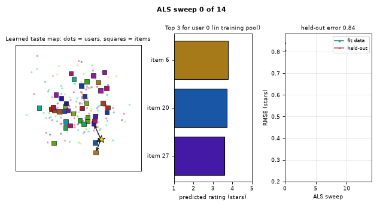
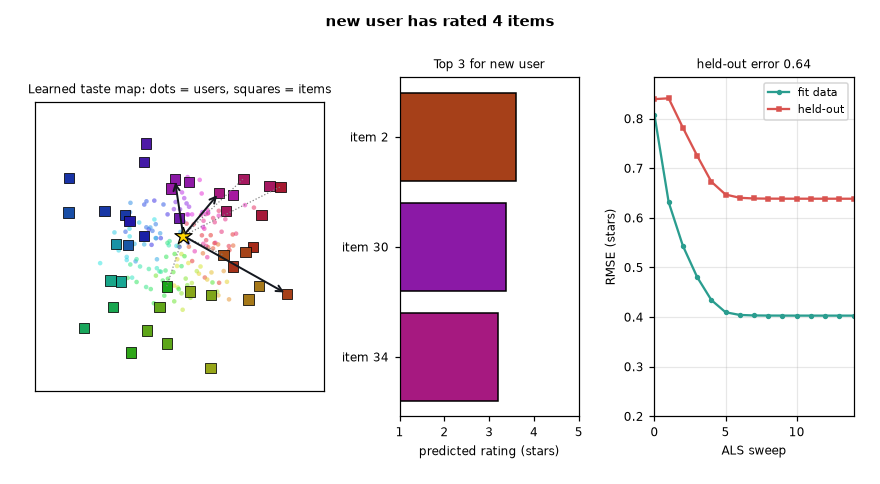
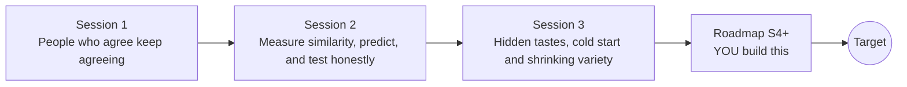

# openrecommend

[](https://github.com/KrunalPanchal1995/openrecommend/actions/workflows/ci.yml)   [](https://colab.research.google.com/github/KrunalPanchal1995/openrecommend/blob/main/sessions/session-01/lesson.ipynb) [](https://krunalpanchal1995.github.io/openrecommend/)

**Build a recommender that suggests what you might like, in three sessions.**

openrecommend teaches how a recommender works, from a 5 by 6 ratings table you fill in by hand to matrix factorisation, cold start and honest testing, using only Python and a browser.

- **Start from zero.** Session 1 is a 5 by 6 table of film ratings that you can solve with pencil and paper.
- **See it move.** Every session ships a slider app that runs in the browser, with labelled graphs.
- **Know you got it right.** Each session ends with a checkpoint that prints PASS or FAIL against hand calculations.
- **Build the missing half.** The repo stops at Session 3 on purpose; the roadmap shows the path to the Target.

[Target](#the-target) · [Who is this for](#who-is-this-for) · [Quick start](#quick-start) · [Sessions](#sessions) · [Roadmap](#roadmap) · [Contribute](#contribute) · [Explainer PDF](docs/explainer.pdf)

> **This repo is incomplete on purpose.** Sessions 1 to 3 are here and fully working. The finished Target below is a preview of what the community can build next. We show you the path, not the code. Sessions 4 and up are yours.

## The Target

A map of 150 synthetic users (dots) and 40 items (squares) takes shape as the model learns hidden tastes sweep by sweep, while the held-out error falls from about 0.84 to about 0.64 stars. Then a brand-new user rates six items one at a time: a star moves across the map and the top-3 recommendation list (arrows and bars) changes after every rating. Your goal over the coming sessions: build that yourself, with bias terms and a map you can read.



*Target: a learned taste map, a recommendation list that updates, and held-out error falling over ALS sweeps*



*Still frame of the Target: the new user has rated 4 items*

Try it live:

- [Math Visual Studio (Studio root)](https://krunalpanchal1995.github.io/studio/)

How the Target was made is shown only as a path in [promo/roadmap.md](promo/roadmap.md).

## Who is this for
**higher secondary to advanced undergraduate (levels 4-6).** Topic area: Artificial Intelligence, Data Science and Robotics.

Prerequisites:

- School arithmetic and averages; the idea of a table of numbers (rows and columns).
- Python 3.10 or newer; if `python --version` works, you are ready. PRIMER.md explains the rest.
- No prior GitHub, machine learning or linear algebra experience is needed; matrices are explained when they first appear.

New to Python? Read [PRIMER.md](PRIMER.md) first (10 minutes).

## Quick start

No installation knowledge needed. You need [Git](https://git-scm.com/downloads) and [Python 3.10+](https://www.python.org/downloads/) (Windows: tick "Add Python to PATH"). On Mac and Linux type `python3` wherever this page says `python`.

```bash
git clone https://github.com/KrunalPanchal1995/openrecommend.git
cd openrecommend
python start.py 1
```

`start.py` creates a private environment, installs what is needed and runs Session 1 with its checkpoint. Next: `python start.py 2`, `python start.py 3`, or `python start.py test` to check everything. Only a checkpoint: `python start.py check 1`.

A few lines turn the idea of Session 1 into a result (they work as they are): Save it as `try.py` and run it with `python start.py run try.py` (this uses the private environment, where NumPy is installed):

```python
import numpy as np
ana = np.array([5, 4, 1, 2, 4])     # Ana's ratings of 5 films
eli = np.array([5, 5, 2, 1, 4])     # Eli rated the same 5 films
print(np.abs(ana - eli).mean())     # -> 0.6   small average gap = similar taste
print(round(np.corrcoef(ana, eli)[0, 1], 3))   # -> 0.888   Pearson similarity
```

Every session also opens in your browser with sliders (no install): [live apps](https://krunalpanchal1995.github.io/openrecommend/). Or use the Colab badge above for the notebook.

## Sessions

| # | Session | Model level | Time | Live app |
|---|---|---|---|---|
| 1 | [People who agree keep agreeing](sessions/session-01/README.md) | Level 1: conceptual interactive model | 60 min | [open](https://krunalpanchal1995.github.io/openrecommend/session-01/) |
| 2 | [Measure similarity, predict, and test honestly](sessions/session-02/README.md) | Level 2: mathematical engineering model | 75 min | [open](https://krunalpanchal1995.github.io/openrecommend/session-02/) |
| 3 | [Hidden tastes, cold start and shrinking variety](sessions/session-03/README.md) | Level 3: simulation and validation | 90 min | [open](https://krunalpanchal1995.github.io/openrecommend/session-03/) |

Each session follows the same six steps: A real-world problem, B concept and theory, C visual explanation, D interactive simulation, E worked example and experiment, F assessment and design challenge. Each ends with `checkpoint.py`, which prints `PASS` or `FAIL` against reference numbers. Session 3 also contains the real-world mini-project: **Recommend 3 items for a new user and beat the popularity baseline**.

## Architecture



| Folder or file | What is inside |
|---|---|
| `sessions/` | three sessions: README (A-F), `lesson.py`, notebook, live app, exercises, activity sheet, checkpoint |
| `promo/` | the Target: media, live links, and the roadmap (path only) |
| `docs/` | `explainer.tex` and the built `explainer.pdf` |
| `tests/` | runs every lesson and checkpoint headless |
| `start.py` | one command to set up and run anything |
| `QUALITY.md`, `RUBRIC.md` | the quality checklist and the scoring rubric |
| `.github/` | CI, PDF build, Pages deploy, issue and PR templates |

## Roadmap

| Milestone | What you will build | Difficulty |
|---|---|---|
| Session 4: Add bias terms | ALS where the model is mu plus a user bias plus an item bias plus the factor match, each bias solved in the same alternating loop. | intermediate |
| Session 5: A smarter cold start | A recommender for new users that blends fold-in scores with item average ratings. | intermediate |
| Session 6: Variety-aware ranking | A re-ranker that penalises items that have already been recommended to many users. | advanced |
| Session 7: Closed-loop simulation | A simulation of 8 rounds where every user is shown 5 unseen items, rates them with the true rating, and the model is refit. | advanced |

Full detail with a checkpoint per milestone: [promo/roadmap.md](promo/roadmap.md).

## Contribute
New to GitHub? Read [CONTRIBUTING.md](CONTRIBUTING.md); it starts from zero. Pick an issue labelled `good first issue`. Translations into Hindi, Telugu, Tamil and Malayalam are welcome.

<details>
<summary>Development</summary>

```bash
python start.py test        # runs every lesson and checkpoint
```
Lessons use `# %%` cell markers so they open as notebooks in VS Code. See [QUALITY.md](QUALITY.md) for the standard every session meets.
</details>

## License
MIT. See [LICENSE](LICENSE). Media in `promo/media` is (c) Krunal Panchal, CC BY 4.0.

## Acknowledgments
Part of the [PAN IIT OSS](https://hellofoss.tech-iitb.org/projects) open-source teaching collection, modelled on the structure of [openspline](https://github.com/openspline/openspline). Built on ideas from the Math Visual Studio at https://krunalpanchal1995.github.io/studio/.
