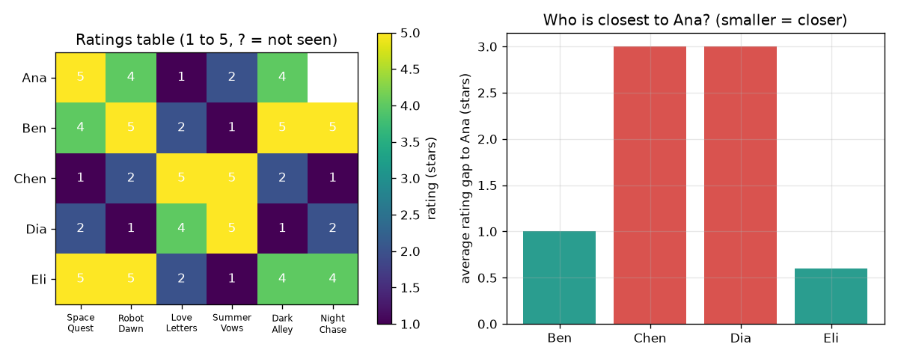

# सत्र 1: जो लोग सहमत होते हैं, वे सहमत होते रहते हैं

*स्तर 1 (वैचारिक इंटरैक्टिव मॉडल) · लगभग 60 मिनट · openrecommend*

> यह एक सरलीकृत शैक्षिक मॉडल है। यह कोई प्रमाणित डिज़ाइन टूल नहीं है और इसका उपयोग वास्तविक संरचनाओं, बिजली की वायरिंग (electrical installations), वाहनों, औद्योगिक प्रक्रियाओं या चिकित्सा निर्णयों के लिए नहीं किया जाना चाहिए।

**पूर्व-आवश्यकताएँ (Prerequisites)**

- स्कूल का अंकगणित: औसत और निरपेक्ष अंतर (absolute differences)।
- आपने PRIMER.md पढ़ लिया है और एक बार `python start.py 1` चलाया है।

**सीखने के उद्देश्य (Learning objectives).** इस सत्र के बाद आप:

- खाली कोष्ठकों वाली रेटिंग तालिका (ratings table) पढ़ सकेंगे।
- दो लोगों के बीच उन फ़िल्मों पर औसत रेटिंग अंतर (gap) गणना कर सकेंगे जो दोनों ने देखी हैं।
- सबसे निकट व्यक्ति से, या k सबसे निकट लोगों से, किसी छूटी हुई रेटिंग का अनुमान लगा सकेंगे।
- समझा सकेंगे कि 'जिन लोगों को एक जैसी चीज़ें पसंद आईं, उन्हें एक जैसी नई चीज़ें पसंद आती हैं' एक अनुमान है, तथ्य नहीं।

## A. वास्तविक दुनिया की समस्या
एक वीडियो ऐप में हज़ारों फ़िल्में हैं और आपने उनमें से मुट्ठी भर देखी हैं। उसे आपको आगे कौन-सी दिखानी चाहिए? वह आपका मन नहीं पढ़ सकता, पर वह उन दूसरे लोगों को देख सकता है जिन्होंने आपकी जैसी फ़िल्मों को रेटिंग दी, और देख सकता है कि उन्हें आगे क्या पसंद आया। आज आप यह 5 काल्पनिक लोगों और 6 काल्पनिक फ़िल्मों की तालिका पर हाथ से करेंगे, फिर Python से इसे दोहरवाएँगे। (यह केवल शिक्षा है: यह एक शिक्षण खिलौना है, क्या देखें या क्या ख़रीदें इस पर सलाह नहीं।)

## B. अवधारणा और सिद्धांत
रेटिंग तालिका में हर व्यक्ति के लिए एक पंक्ति और हर फ़िल्म के लिए एक स्तंभ होता है; हर कोष्ठक 1 (बिल्कुल नापसंद) से 5 (बहुत पसंद) तक की एक रेटिंग है, या खाली है यदि व्यक्ति ने वह फ़िल्म नहीं देखी। दो लोगों की तुलना करने के लिए हम केवल उन फ़िल्मों को देखते हैं जिन्हें दोनों ने रेटिंग दी है (सह-रेटेड (co-rated) फ़िल्में), हर फ़िल्म पर उनकी रेटिंग का अंतर लेते हैं, चिह्न को अनदेखा करते हैं, और औसत निकालते हैं। छोटे औसत अंतर का अर्थ है मिलती-जुलती रुचि। किसी छूटी हुई रेटिंग का अनुमान लगाने के लिए, सबसे छोटे अंतर वाले उन k लोगों को ढूँढिए जिन्होंने वह फ़िल्म रेट की है और उसकी उनकी रेटिंग का औसत निकालिए। सबसे ऊँचे अनुमान वाली फ़िल्म अनुशंसा (recommendation) है।

| प्रतीक | अर्थ | इकाई |
|---|---|---|
| r(a, f) | व्यक्ति a की फ़िल्म f के लिए रेटिंग | सितारे (1 से 5) |
| both | दोनों व्यक्तियों द्वारा रेट की गई फ़िल्मों का समुच्चय | कोई इकाई नहीं |
| gap(a, b) | सह-रेटेड फ़िल्मों पर औसत निरपेक्ष रेटिंग अंतर | सितारे |
| k | अनुमान के लिए प्रयुक्त सबसे निकट लोगों की संख्या | कोई इकाई नहीं |
| guess(a, f) | व्यक्ति a के लिए फ़िल्म f की अनुमानित रेटिंग | सितारे |

**मान्यताएँ (Assumptions)**

- रेटिंग ईमानदार हैं और एक ही पैमाने का अर्थ सबके लिए एक ही है।
- रेटिंग देने और अनुशंसा करने के समय के बीच रुचियाँ वैसी ही रहती हैं।
- इस रिपॉज़िटरी का सारा डेटा कृत्रिम (synthetic) है; किसी की प्रोफ़ाइलिंग नहीं हो रही।

$$ \mathrm{gap}(a,b)=\frac{1}{|\mathrm{both}|}\sum_{f\in \mathrm{both}}\left|r(a,f)-r(b,f)\right| $$

$$ \mathrm{guess}(a,f)=\frac{1}{k}\sum_{b\in N_k(a,f)} r(b,f) $$

## C. दृश्य व्याख्या
चित्र का बायाँ भाग रेटिंग तालिका को एक रंगीन ग्रिड के रूप में दिखाता है जिसमें वहाँ प्रश्नचिह्न है जहाँ Ana ने Night Chase नहीं देखी। दायाँ भाग Ana से बाक़ी चार लोगों में से हर एक तक का औसत अंतर दर्शाता है: Eli का बार सबसे छोटा है (0.6 सितारे), Ben का 1.0 है, और Chen तथा Dia बहुत दूर हैं, हर एक 3.0 पर। Chen और Dia को रोमांस पसंद है, Ana को अंतरिक्ष और थ्रिलर, इसलिए उनके अंतर बड़े हैं।

*बाएँ: 5 गुणा 6 रेटिंग तालिका। दाएँ: Eli, Ana के सबसे निकट व्यक्ति है (अंतर 0.6 सितारे)।*

## D. इंटरैक्टिव सिमुलेशन
पाठ चलाइए (`python start.py 1`), फिर लाइव ऐप खोलिए: [सत्र 1: Ana के सबसे निकट कौन है?](https://krunalpanchal1995.github.io/openrecommend/session-01/) (या इसी फ़ोल्डर में `app.html`)। स्लाइडरों से Ana की रेटिंग बदलिए और अंतरों तथा Night Chase के अनुमान को बदलते देखिए, फिर अंतर बारों पर जाइए और देखिए कि कौन-से लोग हरे हो जाते हैं।

**चुनौती।** Ana को रोमांस का प्रशंसक बनाइए: Space Quest को अधिकतम 2, Love Letters को कम से कम 4 और Dark Alley को अधिकतम 2 रेटिंग दीजिए, और Night Chase के अनुमान को गिरते देखिए।

## E. हल किया गया उदाहरण और प्रयोग
**समस्या।** Ana ने Night Chase नहीं देखी है। तालिका का उपयोग करके 1 सबसे निकट व्यक्ति के साथ और 2 सबसे निकट लोगों के साथ उसकी रेटिंग का अनुमान लगाइए।

1. Ana की तुलना Eli से उन 5 फ़िल्मों पर कीजिए जो दोनों ने रेट की हैं: अंतर 0, 1, 1, 1 और 0 हैं, इसलिए औसत अंतर 3 / 5 = 0.6 सितारे है।
2. इसी तरह Ben का अंतर 5 / 5 = 1.0 है, और Chen तथा Dia हर एक का अंतर 15 / 5 = 3.0 है।
3. सबसे निकट व्यक्ति Eli है (0.6)। Eli ने Night Chase को 4 रेटिंग दी, इसलिए k = 1 के साथ अनुमान 4 सितारे है।
4. दो सबसे निकट लोग Eli (0.6) और Ben (1.0) हैं। Ben ने Night Chase को 5 रेटिंग दी, इसलिए k = 2 के साथ अनुमान (4 + 5) / 2 = 4.5 सितारे है।

**उत्तर।** एक पड़ोसी के साथ अनुमान 4 सितारे और दो के साथ 4.5 सितारे; Night Chase, Ana के लिए अनुशंसा है।

**प्रयोग।** 5 मित्रों से उन्हीं 6 फ़िल्मों (या गानों, या नाश्तों) को 1 से 5 तक रेट करने को कहिए और जानबूझकर एक कोष्ठक खाली छोड़िए। हाथ से अंतर गणना कीजिए और खाली कोष्ठक का अनुमान लगाइए, फिर उस व्यक्ति से वास्तविक रेटिंग पूछिए। इतने कम लोगों के साथ आप अक्सर 1 सितारे या अधिक से ग़लत होंगे। मॉडल एक छोटे से नमूने पर सटीक अंकगणित है: वास्तविकता भिन्न होती है क्योंकि रुचियाँ मूड पर, आपने किसके साथ देखा इस पर निर्भर करती हैं, और क्योंकि 5 लोग बहुत नहीं होते।

## F. मूल्यांकन और डिज़ाइन चुनौती
**प्रश्न प्रकार A: वैचारिक।** क्यों न सबको बस सबसे ऊँची औसत रेटिंग वाली फ़िल्म की अनुशंसा कर दी जाए? एक ऐसी स्थिति बताइए जहाँ पड़ोसी विधि बेहतर उत्तर देती है।

संकेत

तालिका में विपरीत रुचि वाले दो लोगों के बारे में सोचिए।

चरण-दर-चरण हल

एक वैश्विक औसत Ana और Chen को एक जैसा मानता है, जबकि उनकी रेटिंग हर फ़िल्म पर असहमत हैं। पड़ोसी विधि केवल उन लोगों की सुनती है जो Ana से सहमत हैं, इसलिए अल्पसंख्यक रुचि-समूह के लिए यह वह अनुशंसा करती है जो उस समूह को पसंद है (अंतरिक्ष फ़िल्में), न कि जो बहुमत को पसंद है। इसकी कमज़ोरी: लोगों की तुलना करने के लिए इसे साझा फ़िल्में चाहिए, और जब कम लोगों ने फ़िल्म रेट की हो तो यह ग़लत हो सकती है।

**प्रश्न प्रकार B: संख्यात्मक।** Ben और Eli दोनों ने सभी 6 फ़िल्में रेट कीं: Ben ने 4, 5, 2, 1, 5, 5 दिए और Eli ने 5, 5, 2, 1, 4, 4। उनके बीच औसत रेटिंग अंतर ज्ञात कीजिए और बताइए कि क्या वे मिलते-जुलते हैं। इकाई दीजिए।

संकेत

6 फ़िल्मों में से हर एक पर निरपेक्ष अंतर लीजिए, जोड़िए, 6 से भाग दीजिए।

चरण-दर-चरण हल

अंतर 1, 0, 0, 0, 1, 1 हैं, जिनका योग 3 है; 3 / 6 = 0.5 सितारे। 5-सितारा पैमाने पर आधे सितारे के अंतर का अर्थ है बहुत मिलती-जुलती रुचि। समझदारी जाँच (sanity check): अंतर कभी 4 सितारों (1 बनाम 5) से बड़ा नहीं हो सकता और केवल समान रेटिंग के लिए 0 होता है।

**प्रश्न प्रकार C: ग्राफ़ और सिमुलेशन की व्याख्या।** Ana से अंतरों के बार चार्ट में, कौन-से दो लोग सबसे निकट हैं, और यदि हम 2 सबसे निकट के बजाय चारों लोगों का उपयोग करें तो अनुमान क्या हो जाता है?

संकेत

दो सबसे छोटे बार पढ़िए, फिर Night Chase की सबकी रेटिंग का औसत निकालिए (Ben 5, Chen 1, Dia 2, Eli 4)।

चरण-दर-चरण हल

Eli (0.6) और Ben (1.0) सबसे निकट हैं। चारों लोगों का उपयोग करने से (5 + 1 + 2 + 4) / 4 = 3.0 सितारे मिलते हैं: Ana से असहमत दो लोग अनुमान को 4.5 से 3.0 तक नीचे खींच लेते हैं। इसीलिए हम केवल सबसे निकट लोगों का उपयोग करते हैं।

**प्रश्न प्रकार D: डिज़ाइन और अनुकूलन (optimisation) चुनौती।** डिज़ाइन: Night Chase के लिए Ana की रेटिंग का अनुमान लगाने के लिए आप k = 1, 2 या 4 पड़ोसियों का उपयोग कर सकते हैं। तीनों अनुमानों की तुलना कीजिए और एक चुनिए। समझौता (trade-off) बताइए।

संकेत

`predict(RATINGS, 0, 5, k)` से हर k के लिए अनुमान गणना कीजिए और सत्र 1 में हाथ से मिले परिणाम से तुलना कीजिए।

चरण-दर-चरण हल

k = 1 से 4.0, k = 2 से 4.5 और k = 4 से 3.0 मिलता है। k = 1 के साथ अनुमान एक ही व्यक्ति पर टिका है, इसलिए एक असामान्य रेटिंग भटका सकती है; k = 4 के साथ सब गिने जाते हैं, उन लोगों सहित जो Ana से असहमत हैं, इसलिए अनुमान उसकी रुचि को अनदेखा कर देता है। इतनी छोटी तालिका में k = 2 एक समझदार समझौता है: दो लोग जो उससे सहमत हैं। बड़ी तालिका के साथ बड़ा k शोर (noise) को औसत करके हटा देता है, जब तक पड़ोसी वास्तव में मिलते-जुलते हों।

[RUBRIC.md](../../RUBRIC.md) से स्वयं को अंक दीजिए। काग़ज़ पर काम करने के लिए [गतिविधि पत्रक (activity sheet)](activity_sheet.md) प्रिंट कीजिए।

## आम भ्रांतियाँ (Common misconceptions)
| आम भ्रांति | वास्तव में क्या सही है |
|---|---|
| जिस व्यक्ति ने कोई फ़िल्म रेट नहीं की, वह उसे नापसंद करता है। | खाली कोष्ठक का अर्थ है अज्ञात, 'कम' नहीं। इसे 0 मानने से हर अनदेखी फ़िल्म बुरी लगेगी। |
| छोटा अंतर सिद्ध करता है कि दो लोग हमेशा सहमत होंगे। | अंतर केवल उन फ़िल्मों को मापता है जो दोनों ने रेट की हैं; कम साझा फ़िल्मों के साथ यह संयोग हो सकता है। |
| अधिक पड़ोसी हमेशा बेहतर अनुमान देते हैं। | उन लोगों को जोड़ना जो Ana की रुचि साझा नहीं करते, अनुमान को भीड़ के औसत की ओर खींचता है, जैसा k = 4 का उदाहरण दिखाता है। |

## शब्दावली (Glossary)
- **रेटिंग (rating)**: 1 से 5 तक की एक संख्या जो कोई व्यक्ति किसी फ़िल्म को देता है
- **सह-रेटेड (co-rated)**: तुलना किए जा रहे दोनों लोगों द्वारा रेट किया गया
- **अंतर (gap)**: दो लोगों की रेटिंग के बीच औसत निरपेक्ष अंतर; छोटा होने का अर्थ है मिलते-जुलते
- **पड़ोसी (neighbour)**: उन लोगों में से एक जो उस व्यक्ति से सबसे अधिक मिलते-जुलते हैं जिसके लिए हम अनुमान लगा रहे हैं
- **अनुशंसा (recommendation)**: सबसे ऊँची अनुमानित रेटिंग वाली अनदेखी वस्तु

## समापन
1. [exercises.md](exercises.md) में दिए गए तीन कोडिंग कार्य कीजिए।
2. अपने बदलावों के बाद `python start.py 1` फिर से चलाइए। यह चेकपॉइंट (checkpoint) के साथ समाप्त होता है; जब यह `PASS` प्रिंट करे, तो आपका काम पूरा हुआ। (केवल चेकपॉइंट: `python start.py check 1`।)

आगे: [सत्र 2](../session-02/README.md)
