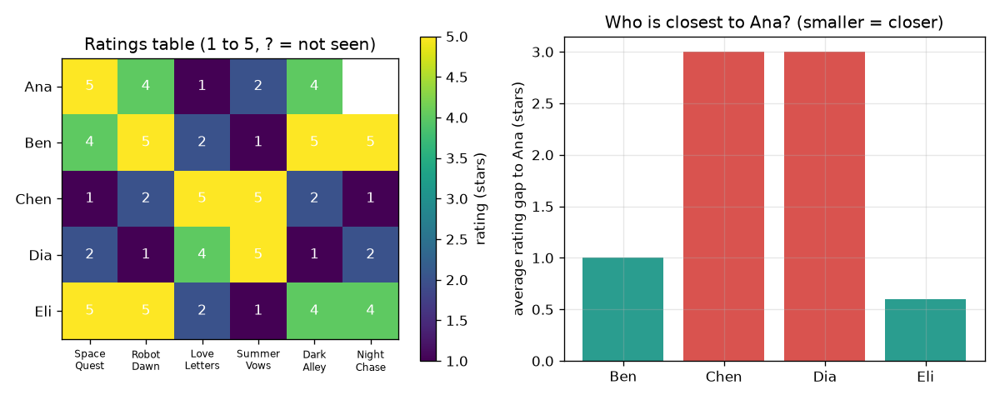

# Session 1: People who agree keep agreeing

*Level 1 (conceptual interactive model) · about 60 minutes · openrecommend*

> This is a simplified educational model. It is not a validated design tool and must not be used for real structures, electrical installations, vehicles, industrial processes or medical decisions.

**Prerequisites**

- School arithmetic: averages and absolute differences.
- You have read PRIMER.md and run `python start.py 1` once.

**Learning objectives.** After this session you can:

- Read a ratings table that has missing cells.
- Compute the average rating gap between two people on the films both have seen.
- Predict a missing rating from the nearest person, or from the k nearest people.
- Explain why 'people who liked the same things like the same new things' is a guess, not a fact.

## A. Real-world problem
A video app has thousands of films and you have seen a handful. Which one should it show you next? It cannot read your mind, but it can look at other people who rated the same films as you and see what they liked next. Today you do this by hand on a table of 5 made-up people and 6 made-up films, then let Python repeat it. (This is education only: it is a teaching toy, not advice on what to watch or buy.)

## B. Concept and theory
A ratings table has one row per person and one column per film; each cell is a rating from 1 (hated it) to 5 (loved it), or empty if the person has not seen the film. To compare two people we look only at the films both have rated (the co-rated films), take the gap between their ratings on each film, ignore the sign, and average. A small average gap means similar taste. To guess a missing rating, find the k people with the smallest gap who have rated that film and average their ratings of it. The film with the highest guess is the recommendation.

| Symbol | Meaning | Unit |
|---|---|---|
| r(a, f) | rating of person a for film f | stars (1 to 5) |
| both | set of films rated by both persons | no unit |
| gap(a, b) | average absolute rating difference over the co-rated films | stars |
| k | number of nearest people used for the guess | no unit |
| guess(a, f) | predicted rating of film f for person a | stars |

**Assumptions**

- Ratings are honest and the same scale means the same thing for everybody.
- Tastes stay the same between the time of rating and the time of recommending.
- All data in this repo is synthetic; nobody is being profiled.

$$ \mathrm{gap}(a,b)=\frac{1}{|\mathrm{both}|}\sum_{f\in \mathrm{both}}\left|r(a,f)-r(b,f)\right| $$

$$ \mathrm{guess}(a,f)=\frac{1}{k}\sum_{b\in N_k(a,f)} r(b,f) $$

## C. Visual explanation
The left panel of the figure is the ratings table as a colour grid with a question mark where Ana has not seen Night Chase. The right panel plots the average gap from Ana to each of the other four people: Eli's bar is the shortest (0.6 stars), Ben's is 1.0, and Chen and Dia are far away at 3.0 each. Chen and Dia like romance, Ana likes space and thrillers, so their gaps are large.

*Left: the 5 by 6 ratings table. Right: Eli is the closest person to Ana (gap 0.6 stars).*

## D. Interactive simulation
Run the lesson (`python start.py 1`), then open the live app: [Session 1: who is closest to Ana?](https://krunalpanchal1995.github.io/openrecommend/session-01/) (or `app.html` in this folder). Change Ana's ratings with the sliders and watch the gaps and the guess for Night Chase change, then switch to the gap bars and see which people turn green.

**Challenge.** Turn Ana into a romance fan: rate Space Quest at most 2, Love Letters at least 4 and Dark Alley at most 2, and watch the guess for Night Chase drop.

## E. Worked example and experiment
**Problem.** Ana has not seen Night Chase. Use the table to guess her rating with 1 nearest person and with 2 nearest people.

1. Compare Ana with Eli on the 5 films both rated: the gaps are 0, 1, 1, 1 and 0, so the average gap is 3 / 5 = 0.6 stars.
2. In the same way Ben has gap 5 / 5 = 1.0, and Chen and Dia each have gap 15 / 5 = 3.0.
3. The nearest person is Eli (0.6). Eli rated Night Chase 4, so the guess with k = 1 is 4 stars.
4. The two nearest people are Eli (0.6) and Ben (1.0). Ben rated Night Chase 5, so with k = 2 the guess is (4 + 5) / 2 = 4.5 stars.

**Answer.** Guess 4 stars with one neighbour and 4.5 stars with two; Night Chase is the recommendation for Ana.

**Experiment.** Ask 5 friends to rate the same 6 films (or songs, or snacks) from 1 to 5 and leave one cell empty on purpose. Compute the gaps by hand and guess the empty cell, then ask the person for the real rating. With so few people you will often be wrong by 1 star or more. The model is exact arithmetic on a tiny sample: reality differs because tastes depend on mood, on who you watched with, and because 5 people are not many.

## F. Assessment and design challenge
**Question type A: Conceptual.** Why not simply recommend the film with the highest average rating to everybody? Name one situation where the neighbour method gives a better answer.

Hint

Think about two people with opposite tastes in the table.

Step-by-step solution

A global average treats Ana and Chen the same, even though their ratings disagree on every film. The neighbour method only listens to people who agree with Ana, so for a taste group that is a minority it recommends what that group likes (space films) rather than what the majority likes. Its weakness: it needs shared films to compare people, and it may be wrong when few people have rated the film.

**Question type B: Numerical.** Both Ben and Eli rated all 6 films: Ben gave 4, 5, 2, 1, 5, 5 and Eli gave 5, 5, 2, 1, 4, 4. Find the average rating gap between them and say whether they are similar. Give the unit.

Hint

Take the absolute difference on each of the 6 films, add, divide by 6.

Step-by-step solution

The gaps are 1, 0, 0, 0, 1, 1, which add to 3; 3 / 6 = 0.5 stars. A gap of half a star on a 5-star scale means very similar taste. Sanity check: the gap can never be larger than 4 stars (1 against 5) and is 0 only for identical ratings.

**Question type C: Graph and simulation interpretation.** In the bar chart of gaps to Ana, which two people are closest, and what does the guess become if we use all four people instead of the 2 nearest?

Hint

Read the two smallest bars, then average everybody's rating of Night Chase (Ben 5, Chen 1, Dia 2, Eli 4).

Step-by-step solution

Eli (0.6) and Ben (1.0) are closest. Using all four people gives (5 + 1 + 2 + 4) / 4 = 3.0 stars: the two people who disagree with Ana pull the guess down from 4.5 to 3.0. This is why we use only the nearest people.

**Question type D: Design and optimisation challenge.** Design: you may use k = 1, 2 or 4 neighbours to guess Ana's rating for Night Chase. Compare the three guesses and choose one. State the trade-off.

Hint

Compute the guess for each k with `predict(RATINGS, 0, 5, k)` and compare with what Session 1 found by hand.

Step-by-step solution

k = 1 gives 4.0, k = 2 gives 4.5 and k = 4 gives 3.0. With k = 1 the guess rests on a single person, so one unusual rating can mislead; with k = 4 everybody counts, including people who disagree with Ana, so the guess ignores her taste. In a table this small k = 2 is a sensible compromise: two people who agree with her. With a bigger table a larger k averages out noise as long as the neighbours really are similar.

Score yourself with [RUBRIC.md](../../RUBRIC.md). Print the [activity sheet](activity_sheet.md) to work on paper.

## Common misconceptions
| Common misconception | What is actually true |
|---|---|
| A person who has not rated a film dislikes it. | An empty cell means unknown, not 'low'. Treating it as 0 would make every unseen film look bad. |
| A small gap proves two people will always agree. | The gap only measures the films they both rated; with few shared films it can be a coincidence. |
| More neighbours always give a better guess. | Adding people who do not share Ana's taste drags the guess towards the crowd average, as the k = 4 example shows. |

## Glossary
- **rating**: a number from 1 to 5 that a person gives a film
- **co-rated**: rated by both of the two people being compared
- **gap**: average absolute difference between two people's ratings; small means similar
- **neighbour**: one of the people most similar to the person we are guessing for
- **recommendation**: the unseen item with the highest guessed rating

## Finish
1. Do the three coding tasks in [exercises.md](exercises.md).
2. Run `python start.py 1` again after your changes. It ends with the checkpoint; when it prints `PASS`, you are done. (Checkpoint only: `python start.py check 1`.)

Next: [Session 2](../session-02/README.md)
