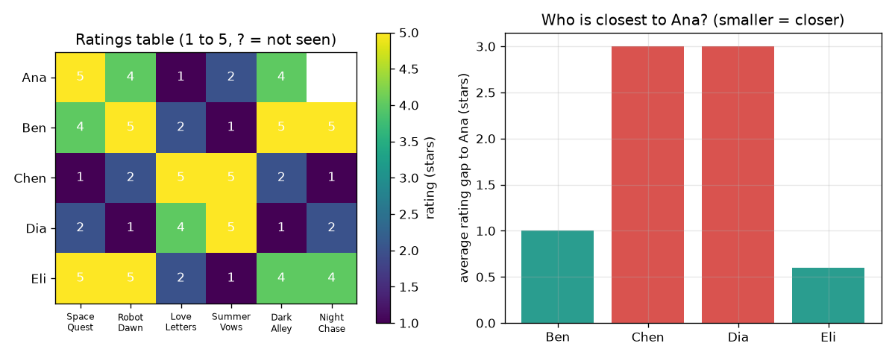

# സെഷൻ 1: യോജിക്കുന്നവർ യോജിച്ചുകൊണ്ടേയിരിക്കും

[Session 1 — हिन्दी](README.hi.md)

*ലെവൽ 1 (ആശയപരമായ ഇന്ററാക്ടീവ് മോഡൽ) · ഏകദേശം 60 മിനിറ്റ് · openrecommend*

> ഇത് ലളിതമാക്കിയ ഒരു വിദ്യാഭ്യാസ മോഡൽ (educational model) ആണ്. ഇത് സാധൂകരിക്കപ്പെട്ട ഒരു ഡിസൈൻ ഉപകരണമല്ല; യഥാർത്ഥ നിർമ്മിതികൾ, വൈദ്യുത ഇൻസ്റ്റലേഷനുകൾ, വാഹനങ്ങൾ, വ്യാവസായിക പ്രക്രിയകൾ അല്ലെങ്കിൽ വൈദ്യശാസ്ത്ര തീരുമാനങ്ങൾ എന്നിവയ്ക്ക് ഇത് ഉപയോഗിക്കരുത്.

**മുൻ‌അറിവ് (Prerequisites)**

- സ്കൂൾ ഗണിതം: ശരാശരിയും കേവല വ്യത്യാസങ്ങളും.
- നിങ്ങൾ PRIMER.md വായിക്കുകയും `python start.py 1` ഒരിക്കൽ റൺ ചെയ്യുകയും ചെയ്തിട്ടുണ്ട്.

**പഠന ലക്ഷ്യങ്ങൾ (Learning objectives).** ഈ സെഷനു ശേഷം നിങ്ങൾക്ക് കഴിയും:

- ശൂന്യമായ കളങ്ങളുള്ള ഒരു റേറ്റിംഗ് പട്ടിക വായിക്കാൻ.
- രണ്ടുപേരും കണ്ട സിനിമകളിൽ അവരുടെ റേറ്റിംഗുകൾ തമ്മിലുള്ള ശരാശരി വ്യത്യാസം കണക്കാക്കാൻ.
- ഏറ്റവും അടുത്ത വ്യക്തിയിൽ നിന്ന്, അല്ലെങ്കിൽ ഏറ്റവും അടുത്ത k പേരിൽ നിന്ന് ഒരു ശൂന്യ റേറ്റിംഗ് പ്രവചിക്കാൻ.
- 'ഒരേ കാര്യങ്ങൾ ഇഷ്ടപ്പെട്ടവർ ഒരേ പുതിയ കാര്യങ്ങളും ഇഷ്ടപ്പെടും' എന്നത് ഒരു ഊഹമാണ്, വസ്തുതയല്ല എന്ന് വിശദീകരിക്കാൻ.

## A. യഥാർത്ഥ ജീവിതത്തിലെ പ്രശ്നം
ഒരു വീഡിയോ ആപ്പിൽ ആയിരക്കണക്കിന് സിനിമകളുണ്ട്, നിങ്ങൾ കണ്ടത് കുറച്ച് മാത്രം. അടുത്തതായി അത് നിങ്ങൾക്ക് ഏത് കാണിക്കണം? അതിന് നിങ്ങളുടെ മനസ്സ് വായിക്കാനാവില്ല, പക്ഷേ നിങ്ങൾ റേറ്റ് ചെയ്ത അതേ സിനിമകൾ റേറ്റ് ചെയ്ത മറ്റുള്ളവരെ നോക്കി അവർ അടുത്തതായി എന്ത് ഇഷ്ടപ്പെട്ടു എന്ന് കാണാൻ കഴിയും. ഇന്ന് നിങ്ങൾ ഇത് 5 സാങ്കൽപ്പിക ആളുകളും 6 സാങ്കൽപ്പിക സിനിമകളും ഉള്ള ഒരു പട്ടികയിൽ കൈകൊണ്ട് ചെയ്യുന്നു, പിന്നെ Python അത് ആവർത്തിക്കട്ടെ. (ഇത് വിദ്യാഭ്യാസത്തിന് മാത്രമാണ്: ഇതൊരു പഠന കളിപ്പാട്ടമാണ്, എന്ത് കാണണം അല്ലെങ്കിൽ വാങ്ങണം എന്നതിനുള്ള ഉപദേശമല്ല.)

## B. ആശയവും സിദ്ധാന്തവും
ഒരു റേറ്റിംഗ് പട്ടികയിൽ ഓരോ വ്യക്തിക്കും ഒരു വരിയും ഓരോ സിനിമയ്ക്കും ഒരു കോളവും ഉണ്ട്; ഓരോ കളവും 1 (ഇഷ്ടപ്പെട്ടില്ല) മുതൽ 5 (വളരെ ഇഷ്ടപ്പെട്ടു) വരെയുള്ള ഒരു റേറ്റിംഗാണ്, വ്യക്തി സിനിമ കണ്ടിട്ടില്ലെങ്കിൽ കളം ശൂന്യമായിരിക്കും. രണ്ടുപേരെ താരതമ്യം ചെയ്യാൻ ഇരുവരും റേറ്റ് ചെയ്ത സിനിമകൾ (co-rated films) മാത്രം നോക്കുന്നു, ഓരോ സിനിമയിലും അവരുടെ റേറ്റിംഗുകൾ തമ്മിലുള്ള വ്യത്യാസം എടുക്കുന്നു, ചിഹ്നം അവഗണിക്കുന്നു, ശരാശരി എടുക്കുന്നു. ചെറിയ ശരാശരി വ്യത്യാസം എന്നാൽ സമാനമായ അഭിരുചി. ഒരു ശൂന്യ റേറ്റിംഗ് ഊഹിക്കാൻ, ആ സിനിമ റേറ്റ് ചെയ്തവരിൽ ഏറ്റവും ചെറിയ വ്യത്യാസമുള്ള k പേരെ കണ്ടെത്തി അവരുടെ റേറ്റിംഗുകളുടെ ശരാശരി എടുക്കുക. ഏറ്റവും ഉയർന്ന ഊഹമുള്ള സിനിമയാണ് ശുപാർശ.

| ചിഹ്നം | അർത്ഥം | യൂണിറ്റ് |
|---|---|---|
| r(a, f) | വ്യക്തി a ഫിലിം f-ന് നൽകിയ റേറ്റിംഗ് | നക്ഷത്രങ്ങൾ (1 മുതൽ 5 വരെ) |
| both | ഇരുവരും റേറ്റ് ചെയ്ത സിനിമകളുടെ ഗണം | യൂണിറ്റ് ഇല്ല |
| gap(a, b) | ഇരുവരും റേറ്റ് ചെയ്ത സിനിമകളിലെ ശരാശരി കേവല റേറ്റിംഗ് വ്യത്യാസം | നക്ഷത്രങ്ങൾ |
| k | ഊഹത്തിന് ഉപയോഗിക്കുന്ന ഏറ്റവും അടുത്ത ആളുകളുടെ എണ്ണം | യൂണിറ്റ് ഇല്ല |
| guess(a, f) | വ്യക്തി a-ക്ക് ഫിലിം f-ന്റെ പ്രവചിച്ച റേറ്റിംഗ് | നക്ഷത്രങ്ങൾ |

**അനുമാനങ്ങൾ (Assumptions)**

- റേറ്റിംഗുകൾ സത്യസന്ധമാണ്, ഒരേ സ്കെയിൽ എല്ലാവർക്കും ഒരേ അർത്ഥം നൽകുന്നു.
- റേറ്റ് ചെയ്ത സമയത്തിനും ശുപാർശ ചെയ്യുന്ന സമയത്തിനും ഇടയിൽ അഭിരുചികൾ മാറുന്നില്ല.
- ഈ റിപ്പോസിറ്ററിയിലെ എല്ലാ ഡാറ്റയും കൃത്രിമമാണ്; ആരുടെയും പ്രൊഫൈൽ ഉണ്ടാക്കുന്നില്ല.

$$ \mathrm{gap}(a,b)=\frac{1}{|\mathrm{both}|}\sum_{f\in \mathrm{both}}\left|r(a,f)-r(b,f)\right| $$

$$ \mathrm{guess}(a,f)=\frac{1}{k}\sum_{b\in N_k(a,f)} r(b,f) $$

## C. ദൃശ്യ വിശദീകരണം
ചിത്രത്തിന്റെ ഇടത് ഭാഗം റേറ്റിംഗ് പട്ടികയാണ്, ഒരു കളർ ഗ്രിഡായി, ആന Night Chase കണ്ടിട്ടില്ലാത്തിടത്ത് ഒരു ചോദ്യചിഹ്നത്തോടെ. വലത് ഭാഗം ആനയിൽ നിന്ന് മറ്റ് നാലുപേരിലേക്കുള്ള ശരാശരി വ്യത്യാസം വരയ്ക്കുന്നു: എലിയുടെ ബാർ ഏറ്റവും ചെറുതാണ് (0.6 നക്ഷത്രം), ബെന്നിന്റേത് 1.0, ചെനും ഡിയയും ഓരോരുത്തരും 3.0 ആയി ഏറെ അകലെയാണ്. ചെനും ഡിയയും പ്രണയ സിനിമകൾ ഇഷ്ടപ്പെടുന്നു, ആന ബഹിരാകാശ, ത്രില്ലർ സിനിമകൾ ഇഷ്ടപ്പെടുന്നു, അതിനാൽ അവരുടെ വ്യത്യാസങ്ങൾ വലുതാണ്.

*ഇടത്: 5 x 6 റേറ്റിംഗ് പട്ടിക. വലത്: എലി ആനയോട് ഏറ്റവും അടുത്ത വ്യക്തിയാണ് (വ്യത്യാസം 0.6 നക്ഷത്രം).*

## D. ഇന്ററാക്ടീവ് സിമുലേഷൻ
പാഠം റൺ ചെയ്യുക (`python start.py 1`), എന്നിട്ട് ലൈവ് ആപ്പ് തുറക്കുക: [സെഷൻ 1: ആനയോട് ഏറ്റവും അടുത്തത് ആര്?](https://krunalpanchal1995.github.io/openrecommend/session-01/) (അല്ലെങ്കിൽ ഈ ഫോൾഡറിലെ `app.html`). സ്ലൈഡറുകൾ ഉപയോഗിച്ച് ആനയുടെ റേറ്റിംഗുകൾ മാറ്റി വ്യത്യാസങ്ങളും Night Chase-നുള്ള ഊഹവും മാറുന്നത് നിരീക്ഷിക്കുക, പിന്നെ വ്യത്യാസ ബാറുകളിലേക്ക് മാറി ഏതൊക്കെ ആളുകൾ പച്ചയാകുന്നു എന്ന് കാണുക.

**വെല്ലുവിളി.** ആനയെ ഒരു പ്രണയ സിനിമ ആരാധികയാക്കുക: Space Quest-ന് പരമാവധി 2, Love Letters-ന് കുറഞ്ഞത് 4, Dark Alley-ക്ക് പരമാവധി 2 എന്നിങ്ങനെ റേറ്റ് ചെയ്യുക, Night Chase-നുള്ള ഊഹം താഴുന്നത് കാണുക.

## E. ഉദാഹരണവും പരീക്ഷണവും
**പ്രശ്നം.** ആന Night Chase കണ്ടിട്ടില്ല. പട്ടിക ഉപയോഗിച്ച് 1 അടുത്ത വ്യക്തിയെ ഉപയോഗിച്ചും 2 അടുത്ത ആളുകളെ ഉപയോഗിച്ചും അവളുടെ റേറ്റിംഗ് ഊഹിക്കുക.

1. ഇരുവരും റേറ്റ് ചെയ്ത 5 സിനിമകളിൽ ആനയെ എലിയുമായി താരതമ്യം ചെയ്യുക: വ്യത്യാസങ്ങൾ 0, 1, 1, 1, 0 ആണ്, അതിനാൽ ശരാശരി വ്യത്യാസം 3 / 5 = 0.6 നക്ഷത്രം.
2. ഇതേ രീതിയിൽ ബെന്നിന് വ്യത്യാസം 5 / 5 = 1.0, ചെനിനും ഡിയയ്ക്കും ഓരോരുത്തർക്കും വ്യത്യാസം 15 / 5 = 3.0.
3. ഏറ്റവും അടുത്ത വ്യക്തി എലിയാണ് (0.6). എലി Night Chase-ന് 4 നൽകി, അതിനാൽ k = 1 ഉള്ള ഊഹം 4 നക്ഷത്രം.
4. ഏറ്റവും അടുത്ത രണ്ടുപേർ എലി (0.6), ബെൻ (1.0) എന്നിവരാണ്. ബെൻ Night Chase-ന് 5 നൽകി, അതിനാൽ k = 2 ഉള്ള ഊഹം (4 + 5) / 2 = 4.5 നക്ഷത്രം.

**ഉത്തരം.** ഒരു അയൽക്കാരനെ ഉപയോഗിച്ചാൽ 4 നക്ഷത്രവും രണ്ടുപേരെ ഉപയോഗിച്ചാൽ 4.5 നക്ഷത്രവും ഊഹം; ആനയ്ക്കുള്ള ശുപാർശ Night Chase ആണ്.

**പരീക്ഷണം.** 5 സുഹൃത്തുക്കളോട് ഒരേ 6 സിനിമകൾ (അല്ലെങ്കിൽ പാട്ടുകൾ, അല്ലെങ്കിൽ ലഘുഭക്ഷണങ്ങൾ) 1 മുതൽ 5 വരെ റേറ്റ് ചെയ്യാൻ പറയുക, മനഃപൂർവം ഒരു കളം ശൂന്യമായി വിടുക. വ്യത്യാസങ്ങൾ കൈകൊണ്ട് കണക്കാക്കി ശൂന്യ കളം ഊഹിക്കുക, പിന്നെ ആളോട് യഥാർത്ഥ റേറ്റിംഗ് ചോദിക്കുക. ഇത്രയും കുറച്ച് ആളുകളുള്ളതിനാൽ പലപ്പോഴും 1 നക്ഷത്രമോ അതിൽ കൂടുതലോ തെറ്റും. ഈ മോഡൽ ഒരു ചെറിയ സാമ്പിളിലെ കൃത്യമായ ഗണിതമാണ്: യാഥാർത്ഥ്യം വ്യത്യസ്തമാണ്, കാരണം അഭിരുചികൾ മാനസികാവസ്ഥയെയും ആരോടൊപ്പം കണ്ടു എന്നതിനെയും ആശ്രയിക്കുന്നു, കൂടാതെ 5 ആളുകൾ അധികമല്ല.

## F. വിലയിരുത്തലും ഡിസൈൻ വെല്ലുവിളിയും
**ചോദ്യ തരം A: ആശയപരം.** ഏറ്റവും ഉയർന്ന ശരാശരി റേറ്റിംഗുള്ള സിനിമ എല്ലാവർക്കും ശുപാർശ ചെയ്താൽ പോരേ? അയൽക്കാരുടെ രീതി മികച്ച ഉത്തരം നൽകുന്ന ഒരു സാഹചര്യം പറയുക.

സൂചന

പട്ടികയിൽ വിപരീത അഭിരുചിയുള്ള രണ്ടുപേരെക്കുറിച്ച് ചിന്തിക്കുക.

ഘട്ടം ഘട്ടമായുള്ള പരിഹാരം

ഒരു ആഗോള ശരാശരി ആനയെയും ചെനിനെയും ഒരുപോലെ കണക്കാക്കുന്നു, അവരുടെ റേറ്റിംഗുകൾ എല്ലാ സിനിമകളിലും വിയോജിക്കുന്നുണ്ടെങ്കിലും. അയൽക്കാരുടെ രീതി ആനയോട് യോജിക്കുന്നവരെ മാത്രം കേൾക്കുന്നു, അതിനാൽ ന്യൂനപക്ഷമായ ഒരു അഭിരുചി ഗ്രൂപ്പിന് അത് ഭൂരിപക്ഷം ഇഷ്ടപ്പെടുന്നതല്ല, ആ ഗ്രൂപ്പ് ഇഷ്ടപ്പെടുന്നത് (ബഹിരാകാശ സിനിമകൾ) ശുപാർശ ചെയ്യുന്നു. അതിന്റെ ദൗർബല്യം: ആളുകളെ താരതമ്യം ചെയ്യാൻ പൊതുവായ സിനിമകൾ വേണം, കുറച്ച് ആളുകൾ മാത്രം റേറ്റ് ചെയ്ത സിനിമയാണെങ്കിൽ അത് തെറ്റിയേക്കാം.

**ചോദ്യ തരം B: സംഖ്യാപരം.** ബെനും എലിയും 6 സിനിമകളും റേറ്റ് ചെയ്തു: ബെൻ 4, 5, 2, 1, 5, 5 നൽകി, എലി 5, 5, 2, 1, 4, 4 നൽകി. അവർ തമ്മിലുള്ള ശരാശരി റേറ്റിംഗ് വ്യത്യാസം കണ്ടെത്തുക, അവർ സമാനരാണോ എന്ന് പറയുക. യൂണിറ്റ് നൽകുക.

സൂചന

6 സിനിമകളിലും കേവല വ്യത്യാസം എടുക്കുക, കൂട്ടുക, 6 കൊണ്ട് ഹരിക്കുക.

ഘട്ടം ഘട്ടമായുള്ള പരിഹാരം

വ്യത്യാസങ്ങൾ 1, 0, 0, 0, 1, 1 ആണ്, അവയുടെ ആകെത്തുക 3; 3 / 6 = 0.5 നക്ഷത്രം. 5-നക്ഷത്ര സ്കെയിലിൽ അര നക്ഷത്രത്തിന്റെ വ്യത്യാസം എന്നാൽ വളരെ സമാനമായ അഭിരുചി. യുക്തി പരിശോധന: വ്യത്യാസം ഒരിക്കലും 4 നക്ഷത്രത്തിൽ കൂടുതലാകില്ല (1-ഉം 5-ഉം), റേറ്റിംഗുകൾ ഒരുപോലെ ആയാൽ മാത്രം 0 ആകും.

**ചോദ്യ തരം C: ഗ്രാഫും സിമുലേഷനും വ്യാഖ്യാനിക്കൽ.** ആനയുമായുള്ള വ്യത്യാസങ്ങളുടെ ബാർ ചാർട്ടിൽ ഏറ്റവും അടുത്ത രണ്ടുപേർ ആരാണ്, 2 അടുത്തവർക്ക് പകരം നാലുപേരെയും ഉപയോഗിച്ചാൽ ഊഹം എന്താകും?

സൂചന

ഏറ്റവും ചെറിയ രണ്ട് ബാറുകൾ വായിക്കുക, പിന്നെ Night Chase-നുള്ള എല്ലാവരുടെയും റേറ്റിംഗിന്റെ ശരാശരി എടുക്കുക (ബെൻ 5, ചെൻ 1, ഡിയ 2, എലി 4).

ഘട്ടം ഘട്ടമായുള്ള പരിഹാരം

എലി (0.6), ബെൻ (1.0) എന്നിവർ ഏറ്റവും അടുത്തവരാണ്. നാലുപേരെയും ഉപയോഗിച്ചാൽ (5 + 1 + 2 + 4) / 4 = 3.0 നക്ഷത്രം: ആനയോട് വിയോജിക്കുന്ന രണ്ടുപേർ ഊഹത്തെ 4.5-ൽ നിന്ന് 3.0-ലേക്ക് താഴ്ത്തുന്നു. അതുകൊണ്ടാണ് നമ്മൾ ഏറ്റവും അടുത്ത ആളുകളെ മാത്രം ഉപയോഗിക്കുന്നത്.

**ചോദ്യ തരം D: ഡിസൈനും ഒപ്റ്റിമൈസേഷൻ (optimisation) വെല്ലുവിളിയും.** ഡിസൈൻ: ആനയുടെ Night Chase റേറ്റിംഗ് ഊഹിക്കാൻ നിങ്ങൾക്ക് k = 1, 2 അല്ലെങ്കിൽ 4 അയൽക്കാരെ ഉപയോഗിക്കാം. മൂന്ന് ഊഹങ്ങളും താരതമ്യം ചെയ്ത് ഒന്ന് തിരഞ്ഞെടുക്കുക. ട്രേഡ്-ഓഫ് (trade-off) പറയുക.

സൂചന

ഓരോ k-ക്കും `predict(RATINGS, 0, 5, k)` ഉപയോഗിച്ച് ഊഹം കണക്കാക്കി സെഷൻ 1 കൈകൊണ്ട് കണ്ടെത്തിയതുമായി താരതമ്യം ചെയ്യുക.

ഘട്ടം ഘട്ടമായുള്ള പരിഹാരം

k = 1 ഉള്ളപ്പോൾ 4.0, k = 2 ഉള്ളപ്പോൾ 4.5, k = 4 ഉള്ളപ്പോൾ 3.0. k = 1 ആകുമ്പോൾ ഊഹം ഒരാളെ മാത്രം ആശ്രയിക്കുന്നു, അതിനാൽ ഒരു അസാധാരണ റേറ്റിംഗ് തെറ്റിദ്ധരിപ്പിക്കാം; k = 4 ആകുമ്പോൾ ആനയോട് വിയോജിക്കുന്നവർ ഉൾപ്പെടെ എല്ലാവരും കണക്കിലാകുന്നു, അതിനാൽ ഊഹം അവളുടെ അഭിരുചി അവഗണിക്കുന്നു. ഇത്ര ചെറിയ പട്ടികയിൽ k = 2 ഒരു ന്യായമായ ഒത്തുതീർപ്പാണ്: അവളോട് യോജിക്കുന്ന രണ്ടുപേർ. വലിയ പട്ടികയിൽ, അയൽക്കാർ യഥാർത്ഥത്തിൽ സമാനരാണെങ്കിൽ, വലിയ k ശബ്ദത്തെ (noise) ശരാശരിയിൽ ഇല്ലാതാക്കുന്നു.

[RUBRIC.md](../../RUBRIC.md) ഉപയോഗിച്ച് സ്വയം സ്കോർ ചെയ്യുക. പേപ്പറിൽ ചെയ്യാൻ [ആക്ടിവിറ്റി ഷീറ്റ്](activity_sheet.md) പ്രിന്റ് ചെയ്യുക.

## സാധാരണ തെറ്റിദ്ധാരണകൾ
| സാധാരണ തെറ്റിദ്ധാരണ | യഥാർത്ഥത്തിൽ ശരിയായത് |
|---|---|
| ഒരു സിനിമ റേറ്റ് ചെയ്യാത്ത വ്യക്തിക്ക് അത് ഇഷ്ടമല്ല. | ശൂന്യ കളം എന്നാൽ അറിയില്ല എന്നാണ്, 'കുറവ്' എന്നല്ല. അതിനെ 0 ആയി കണക്കാക്കിയാൽ കാണാത്ത എല്ലാ സിനിമകളും മോശമായി തോന്നും. |
| ചെറിയ വ്യത്യാസം രണ്ടുപേർ എപ്പോഴും യോജിക്കുമെന്ന് തെളിയിക്കുന്നു. | ഇരുവരും റേറ്റ് ചെയ്ത സിനിമകളിൽ മാത്രമേ വ്യത്യാസം അളക്കുന്നുള്ളൂ; പൊതുവായ സിനിമകൾ കുറവാണെങ്കിൽ അത് യാദൃച്ഛികമാകാം. |
| കൂടുതൽ അയൽക്കാർ എപ്പോഴും മികച്ച ഊഹം നൽകുന്നു. | ആനയുടെ അഭിരുചി പങ്കിടാത്തവരെ ചേർക്കുന്നത്, k = 4 ഉദാഹരണം കാണിക്കുന്നതുപോലെ, ഊഹത്തെ ജനക്കൂട്ടത്തിന്റെ ശരാശരിയിലേക്ക് വലിക്കുന്നു. |

## പദാവലി (Glossary)
- **റേറ്റിംഗ് (rating)**: ഒരാൾ സിനിമയ്ക്ക് നൽകുന്ന 1 മുതൽ 5 വരെയുള്ള ഒരു സംഖ്യ
- **ഇരുവരും റേറ്റ് ചെയ്തത് (co-rated)**: താരതമ്യം ചെയ്യുന്ന രണ്ടുപേരും റേറ്റ് ചെയ്തത്
- **വ്യത്യാസം (gap)**: രണ്ടുപേരുടെ റേറ്റിംഗുകൾ തമ്മിലുള്ള ശരാശരി കേവല വ്യത്യാസം; ചെറുത് എന്നാൽ സമാനം
- **അയൽക്കാരൻ (neighbour)**: നമ്മൾ ഊഹിക്കുന്ന വ്യക്തിയോട് ഏറ്റവും സമാനരായവരിൽ ഒരാൾ
- **ശുപാർശ (recommendation)**: ഏറ്റവും ഉയർന്ന ഊഹിച്ച റേറ്റിംഗുള്ള, കാണാത്ത ഇനം

## പൂർത്തിയാക്കുക
1. [exercises.md](exercises.md)-ലെ മൂന്ന് കോഡിംഗ് ടാസ്കുകൾ ചെയ്യുക.
2. മാറ്റങ്ങൾക്കു ശേഷം `python start.py 1` വീണ്ടും റൺ ചെയ്യുക. അത് ചെക്ക്‌പോയിന്റോടെ (checkpoint) അവസാനിക്കുന്നു; അത് `PASS` എന്ന് പ്രിന്റ് ചെയ്യുമ്പോൾ നിങ്ങൾ പൂർത്തിയാക്കി. (ചെക്ക്‌പോയിന്റ് മാത്രം: `python start.py check 1`.)

അടുത്തത്: [സെഷൻ 2](../session-02/README.md)
