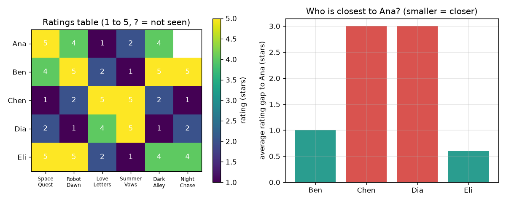

# அமர்வு 1: ஒத்துப்போகிறவர்கள் தொடர்ந்து ஒத்துப்போகிறார்கள்

[Session 1 — हिन्दी](README.hi.md)

*நிலை 1 (கருத்தியல் ஊடாடும் மாதிரி) · சுமார் 60 நிமிடங்கள் · openrecommend*

> இது எளிமைப்படுத்தப்பட்ட ஒரு கல்வி மாதிரி (educational model). இது சரிபார்க்கப்பட்ட வடிவமைப்புக் கருவி அல்ல; உண்மையான கட்டமைப்புகள், மின் நிறுவல்கள், வாகனங்கள், தொழில்துறை செயல்முறைகள் அல்லது மருத்துவ முடிவுகளுக்கு இதைப் பயன்படுத்தக் கூடாது.

**முன்தேவைகள் (Prerequisites)**

- பள்ளிக் கணிதம்: சராசரிகளும் தனிமதிப்பு வேறுபாடுகளும்.
- நீங்கள் PRIMER.md படித்து `python start.py 1` ஒருமுறை இயக்கியிருக்கிறீர்கள்.

**கற்றல் நோக்கங்கள் (Learning objectives).** இந்த அமர்வுக்குப் பிறகு உங்களால் முடியும்:

- காலிக் கட்டங்கள் உள்ள மதிப்பீட்டு அட்டவணையைப் படிக்க.
- இருவரும் பார்த்த படங்களில் அவர்களின் மதிப்பீடுகளுக்கிடையிலான சராசரி இடைவெளியைக் கணக்கிட.
- மிக அருகிலுள்ள நபரிடமிருந்து, அல்லது மிக அருகிலுள்ள k நபர்களிடமிருந்து விடுபட்ட மதிப்பீட்டைக் கணிக்க.
- 'ஒரே விஷயங்களை விரும்பியவர்கள் ஒரே புதிய விஷயங்களையும் விரும்புவார்கள்' என்பது ஒரு ஊகம், உண்மை அல்ல என்று விளக்க.

## A. நிஜ உலகப் பிரச்சினை
ஒரு வீடியோ செயலியில் ஆயிரக்கணக்கான படங்கள் உள்ளன, நீங்கள் சிலவற்றையே பார்த்திருக்கிறீர்கள். அடுத்து எதை உங்களுக்குக் காட்ட வேண்டும்? அது உங்கள் மனதைப் படிக்க முடியாது, ஆனால் நீங்கள் மதிப்பிட்ட அதே படங்களை மதிப்பிட்ட மற்றவர்களைப் பார்த்து, அவர்கள் அடுத்து எதை விரும்பினார்கள் என்று பார்க்க முடியும். இன்று நீங்கள் இதை 5 கற்பனை நபர்களும் 6 கற்பனைப் படங்களும் உள்ள அட்டவணையில் கையால் செய்கிறீர்கள், பிறகு Python அதைத் திரும்பச் செய்யட்டும். (இது கல்விக்கு மட்டும்: இது கற்றலுக்கான பொம்மை, எதைப் பார்க்க அல்லது வாங்க வேண்டும் என்ற ஆலோசனை அல்ல.)

## B. கருத்தும் கோட்பாடும்
ஒரு மதிப்பீட்டு அட்டவணையில் ஒவ்வொரு நபருக்கும் ஒரு வரிசையும் ஒவ்வொரு படத்துக்கும் ஒரு நெடுவரிசையும் உண்டு; ஒவ்வொரு கட்டமும் 1 (வெறுத்தேன்) முதல் 5 (மிகவும் விரும்பினேன்) வரையிலான மதிப்பீடு, நபர் படத்தைப் பார்க்கவில்லை என்றால் கட்டம் காலியாக இருக்கும். இருவரை ஒப்பிட, இருவரும் மதிப்பிட்ட படங்களை (co-rated films) மட்டும் பார்க்கிறோம், ஒவ்வொரு படத்திலும் அவர்களின் மதிப்பீடுகளுக்கிடையிலான இடைவெளியை எடுத்து, குறியை விட்டுவிட்டு, சராசரி காண்கிறோம். சிறிய சராசரி இடைவெளி என்றால் ஒத்த ரசனை. விடுபட்ட மதிப்பீட்டை ஊகிக்க, அந்தப் படத்தை மதிப்பிட்டவர்களில் மிகச் சிறிய இடைவெளி கொண்ட k நபர்களைக் கண்டறிந்து, அவர்களின் மதிப்பீடுகளின் சராசரியை எடுக்கிறோம். அதிக ஊகம் கொண்ட படமே பரிந்துரை.

| குறியீடு | பொருள் | அலகு |
|---|---|---|
| r(a, f) | நபர் a படம் f-க்கு அளித்த மதிப்பீடு | நட்சத்திரங்கள் (1 முதல் 5) |
| both | இருவரும் மதிப்பிட்ட படங்களின் கணம் | அலகு இல்லை |
| gap(a, b) | இருவரும் மதிப்பிட்ட படங்களில் சராசரித் தனிமதிப்பு மதிப்பீட்டு வேறுபாடு | நட்சத்திரங்கள் |
| k | ஊகத்துக்குப் பயன்படுத்தும் மிக அருகிலுள்ள நபர்களின் எண்ணிக்கை | அலகு இல்லை |
| guess(a, f) | நபர் a-க்குப் படம் f-இன் கணிக்கப்பட்ட மதிப்பீடு | நட்சத்திரங்கள் |

**அனுமானங்கள் (Assumptions)**

- மதிப்பீடுகள் நேர்மையானவை, அதே அளவுகோல் அனைவருக்கும் அதே பொருளைத் தருகிறது.
- மதிப்பிட்ட நேரத்துக்கும் பரிந்துரைக்கும் நேரத்துக்கும் இடையே ரசனைகள் மாறுவதில்லை.
- இந்தக் களஞ்சியத்தில் உள்ள எல்லாத் தரவும் செயற்கையானது; யாருடைய விவரமும் தொகுக்கப்படவில்லை.

$$ \mathrm{gap}(a,b)=\frac{1}{|\mathrm{both}|}\sum_{f\in \mathrm{both}}\left|r(a,f)-r(b,f)\right| $$

$$ \mathrm{guess}(a,f)=\frac{1}{k}\sum_{b\in N_k(a,f)} r(b,f) $$

## C. காட்சி விளக்கம்
படத்தின் இடப்பகுதி மதிப்பீட்டு அட்டவணை, வண்ணக் கட்டமாக, ஆனா Night Chase-ஐப் பார்க்காத இடத்தில் கேள்விக்குறியுடன். வலப்பகுதி ஆனாவிலிருந்து மற்ற நால்வருக்கும் உள்ள சராசரி இடைவெளியை வரைகிறது: எலியின் கம்பி மிகக் குறுகியது (0.6 நட்சத்திரம்), பென்னுடையது 1.0, சென்னும் தியாவும் தலா 3.0 உடன் வெகு தொலைவில் உள்ளனர். சென்னும் தியாவும் காதல் படங்களை விரும்புகிறார்கள், ஆனா விண்வெளி மற்றும் திரில்லர் படங்களை விரும்புகிறாள், எனவே அவர்களின் இடைவெளிகள் பெரியவை.

*இடது: 5 x 6 மதிப்பீட்டு அட்டவணை. வலது: எலி ஆனாவுக்கு மிக நெருக்கமான நபர் (இடைவெளி 0.6 நட்சத்திரம்).*

## D. ஊடாடும் உருவகப்படுத்தல் (Interactive simulation)
பாடத்தை இயக்குங்கள் (`python start.py 1`), பிறகு நேரடிச் செயலியைத் திறக்கவும்: [அமர்வு 1: ஆனாவுக்கு மிக நெருக்கமானவர் யார்?](https://krunalpanchal1995.github.io/openrecommend/session-01/) (அல்லது இந்தக் கோப்புறையில் உள்ள `app.html`). ஸ்லைடர்களால் ஆனாவின் மதிப்பீடுகளை மாற்றி, இடைவெளிகளும் Night Chase-க்கான ஊகமும் மாறுவதைக் கவனியுங்கள், பிறகு இடைவெளிக் கம்பிகளுக்கு மாறி யார் பச்சையாகிறார்கள் என்று பாருங்கள்.

**சவால்.** ஆனாவைக் காதல் பட ரசிகையாக்குங்கள்: Space Quest-க்கு அதிகபட்சம் 2, Love Letters-க்கு குறைந்தபட்சம் 4, Dark Alley-க்கு அதிகபட்சம் 2 என மதிப்பிட்டு, Night Chase-க்கான ஊகம் குறைவதைப் பாருங்கள்.

## E. தீர்க்கப்பட்ட எடுத்துக்காட்டும் சோதனையும்
**கணக்கு.** ஆனா Night Chase-ஐப் பார்க்கவில்லை. அட்டவணையைப் பயன்படுத்தி, 1 அருகிலுள்ள நபர் மற்றும் 2 அருகிலுள்ள நபர்களுடன் அவளது மதிப்பீட்டை ஊகியுங்கள்.

1. இருவரும் மதிப்பிட்ட 5 படங்களில் ஆனாவை எலியுடன் ஒப்பிடுங்கள்: இடைவெளிகள் 0, 1, 1, 1, 0, எனவே சராசரி இடைவெளி 3 / 5 = 0.6 நட்சத்திரம்.
2. இதே முறையில் பென்னுக்கு இடைவெளி 5 / 5 = 1.0, சென்னுக்கும் தியாவுக்கும் தலா இடைவெளி 15 / 5 = 3.0.
3. மிக அருகிலுள்ள நபர் எலி (0.6). எலி Night Chase-க்கு 4 அளித்தாள், எனவே k = 1 உடன் ஊகம் 4 நட்சத்திரம்.
4. மிக அருகிலுள்ள இருவர் எலி (0.6) மற்றும் பென் (1.0). பென் Night Chase-க்கு 5 அளித்தான், எனவே k = 2 உடன் ஊகம் (4 + 5) / 2 = 4.5 நட்சத்திரம்.

**விடை.** ஒரு அயலவருடன் 4 நட்சத்திரம், இருவருடன் 4.5 நட்சத்திரம் ஊகம்; ஆனாவுக்கான பரிந்துரை Night Chase.

**சோதனை.** 5 நண்பர்களிடம் அதே 6 படங்களை (அல்லது பாடல்கள், அல்லது தின்பண்டங்கள்) 1 முதல் 5 வரை மதிப்பிடச் சொல்லி, வேண்டுமென்றே ஒரு கட்டத்தைக் காலியாக விடுங்கள். இடைவெளிகளைக் கையால் கணக்கிட்டு காலிக் கட்டத்தை ஊகித்து, பிறகு அந்த நபரிடம் உண்மையான மதிப்பீட்டைக் கேளுங்கள். இவ்வளவு குறைவான நபர்களுடன் நீங்கள் அடிக்கடி 1 நட்சத்திரம் அல்லது அதற்கு மேல் தவறாவீர்கள். மாதிரி என்பது சிறிய மாதிரியில் துல்லியமான கணிதம்: யதார்த்தம் வேறுபடுகிறது, ஏனெனில் ரசனைகள் மனநிலையையும் யாருடன் பார்த்தீர்கள் என்பதையும் சார்ந்தவை, மேலும் 5 நபர்கள் அதிகம் அல்ல.

## F. மதிப்பீடும் வடிவமைப்புச் சவாலும்
**கேள்வி வகை A: கருத்தியல்.** அதிக சராசரி மதிப்பீடு கொண்ட படத்தையே ஏன் எல்லோருக்கும் பரிந்துரைக்கக் கூடாது? அயலவர் முறை சிறந்த விடையைத் தரும் ஒரு சூழ்நிலையைக் கூறுங்கள்.

குறிப்பு

அட்டவணையில் எதிர் ரசனை கொண்ட இருவரைப் பற்றி யோசியுங்கள்.

படிப்படியான தீர்வு

உலகளாவிய சராசரி ஆனாவையும் சென்னையும் ஒரே மாதிரி நடத்துகிறது, அவர்களின் மதிப்பீடுகள் எல்லாப் படங்களிலும் முரண்பட்டாலும். அயலவர் முறை ஆனாவுடன் ஒத்துப்போகிறவர்களை மட்டுமே கேட்கிறது, எனவே சிறுபான்மை ரசனைக் குழுவுக்கு அது பெரும்பான்மை விரும்புவதை அல்ல, அந்தக் குழு விரும்புவதை (விண்வெளிப் படங்கள்) பரிந்துரைக்கிறது. அதன் பலவீனம்: மக்களை ஒப்பிடப் பொதுவான படங்கள் தேவை, சிலர் மட்டுமே மதிப்பிட்ட படத்தில் அது தவறாகலாம்.

**கேள்வி வகை B: எண்ணியல்.** பென்னும் எலியும் 6 படங்களையும் மதிப்பிட்டனர்: பென் 4, 5, 2, 1, 5, 5 அளித்தான், எலி 5, 5, 2, 1, 4, 4 அளித்தாள். அவர்களுக்கிடையிலான சராசரி மதிப்பீட்டு இடைவெளியைக் கண்டறிந்து அவர்கள் ஒத்தவர்களா என்று கூறுங்கள். அலகைத் தருக.

குறிப்பு

6 படங்களிலும் தனிமதிப்பு வேறுபாட்டை எடுத்து, கூட்டி, 6-ஆல் வகுக்கவும்.

படிப்படியான தீர்வு

இடைவெளிகள் 1, 0, 0, 0, 1, 1, அவற்றின் கூட்டுத்தொகை 3; 3 / 6 = 0.5 நட்சத்திரம். 5-நட்சத்திர அளவுகோலில் அரை நட்சத்திர இடைவெளி என்றால் மிகவும் ஒத்த ரசனை. பொருத்தச் சரிபார்ப்பு: இடைவெளி ஒருபோதும் 4 நட்சத்திரத்தைவிடப் பெரிதாகாது (1 எதிர் 5), மதிப்பீடுகள் ஒரே மாதிரி இருந்தால் மட்டுமே 0.

**கேள்வி வகை C: வரைபடம் மற்றும் உருவகப்படுத்தல் விளக்கம்.** ஆனாவுடனான இடைவெளிகளின் கம்பி விளக்கப்படத்தில் மிக நெருக்கமான இருவர் யார், 2 அருகிலுள்ளவர்களுக்குப் பதிலாக நால்வரையும் பயன்படுத்தினால் ஊகம் என்னவாகும்?

குறிப்பு

மிகச் சிறிய இரு கம்பிகளைப் படியுங்கள், பிறகு Night Chase-க்கு எல்லோரின் மதிப்பீட்டின் சராசரியை எடுங்கள் (பென் 5, சென் 1, தியா 2, எலி 4).

படிப்படியான தீர்வு

எலி (0.6), பென் (1.0) மிக நெருக்கமானவர்கள். நால்வரையும் பயன்படுத்தினால் (5 + 1 + 2 + 4) / 4 = 3.0 நட்சத்திரம்: ஆனாவுடன் முரண்படும் இருவர் ஊகத்தை 4.5-இலிருந்து 3.0-க்குக் கீழே இழுக்கிறார்கள். அதனால்தான் மிக அருகிலுள்ளவர்களை மட்டுமே பயன்படுத்துகிறோம்.

**கேள்வி வகை D: வடிவமைப்பு மற்றும் உகப்பாக்கம் (optimisation) சவால்.** வடிவமைப்பு: ஆனாவின் Night Chase மதிப்பீட்டை ஊகிக்க k = 1, 2 அல்லது 4 அயலவர்களைப் பயன்படுத்தலாம். மூன்று ஊகங்களையும் ஒப்பிட்டு ஒன்றைத் தேர்ந்தெடுங்கள். பரிமாற்றத்தை (trade-off) கூறுங்கள்.

குறிப்பு

ஒவ்வொரு k-க்கும் `predict(RATINGS, 0, 5, k)` மூலம் ஊகத்தைக் கணக்கிட்டு, அமர்வு 1 கையால் கண்டதுடன் ஒப்பிடுங்கள்.

படிப்படியான தீர்வு

k = 1 உடன் 4.0, k = 2 உடன் 4.5, k = 4 உடன் 3.0. k = 1 உடன் ஊகம் ஒரே நபரைச் சார்ந்தது, எனவே ஒரு வழக்கத்துக்கு மாறான மதிப்பீடு தவறாக வழிநடத்தலாம்; k = 4 உடன் ஆனாவுடன் முரண்படுபவர்கள் உட்பட எல்லோரும் கணக்கில் வருகிறார்கள், எனவே ஊகம் அவளது ரசனையைப் புறக்கணிக்கிறது. இவ்வளவு சிறிய அட்டவணையில் k = 2 ஒரு நியாயமான சமரசம்: அவளுடன் ஒத்துப்போகும் இருவர். பெரிய அட்டவணையில், அயலவர்கள் உண்மையிலேயே ஒத்தவர்களாக இருக்கும் வரை, பெரிய k இரைச்சலைச் (noise) சராசரியாக்கி நீக்குகிறது.

[RUBRIC.md](../../RUBRIC.md) கொண்டு உங்களை மதிப்பிடுங்கள். தாளில் செய்ய [செயல்பாட்டுத் தாள்](activity_sheet.md)-ஐ அச்சிடுங்கள்.

## பொதுவான தவறான கருத்துகள்
| பொதுவான தவறான கருத்து | உண்மையில் சரியானது |
|---|---|
| ஒரு படத்தை மதிப்பிடாத நபருக்கு அது பிடிக்காது. | காலிக் கட்டம் என்றால் தெரியாது என்று பொருள், 'குறைவு' அல்ல. அதை 0 ஆகக் கருதினால் பார்க்காத ஒவ்வொரு படமும் மோசமாகத் தெரியும். |
| சிறிய இடைவெளி இருவர் எப்போதும் ஒத்துப்போவார்கள் என்பதை நிரூபிக்கிறது. | இடைவெளி இருவரும் மதிப்பிட்ட படங்களை மட்டுமே அளக்கிறது; பொதுவான படங்கள் குறைவாக இருந்தால் அது தற்செயலாக இருக்கலாம். |
| அதிக அயலவர்கள் எப்போதும் சிறந்த ஊகத்தைத் தருகிறார்கள். | ஆனாவின் ரசனையைப் பகிராதவர்களைச் சேர்ப்பது, k = 4 எடுத்துக்காட்டு காட்டுவது போல, ஊகத்தைக் கூட்டத்தின் சராசரியை நோக்கி இழுக்கிறது. |

## சொற்களஞ்சியம் (Glossary)
- **மதிப்பீடு (rating)**: ஒருவர் படத்துக்கு அளிக்கும் 1 முதல் 5 வரையிலான எண்
- **இருவரும் மதிப்பிட்டது (co-rated)**: ஒப்பிடப்படும் இருவரும் மதிப்பிட்டது
- **இடைவெளி (gap)**: இருவரின் மதிப்பீடுகளுக்கிடையிலான சராசரித் தனிமதிப்பு வேறுபாடு; சிறியது என்றால் ஒத்தது
- **அயலவர் (neighbour)**: நாம் ஊகிக்கும் நபருடன் மிக ஒத்தவர்களில் ஒருவர்
- **பரிந்துரை (recommendation)**: அதிக ஊகிக்கப்பட்ட மதிப்பீடு கொண்ட, பார்க்கப்படாத உருப்படி

## முடிவு
1. [exercises.md](exercises.md)-இல் உள்ள மூன்று நிரலாக்கப் பணிகளைச் செய்யுங்கள்.
2. உங்கள் மாற்றங்களுக்குப் பிறகு `python start.py 1` மீண்டும் இயக்குங்கள். அது சோதனைச் சாவடியுடன் (checkpoint) முடிகிறது; அது `PASS` என்று அச்சிடும்போது நீங்கள் முடித்துவிட்டீர்கள். (சோதனைச் சாவடி மட்டும்: `python start.py check 1`.)

அடுத்து: [அமர்வு 2](../session-02/README.md)
