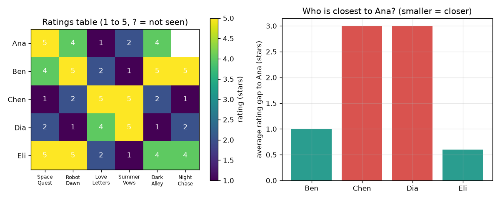

# సెషన్ 1: ఏకీభవించే వారు ఏకీభవిస్తూనే ఉంటారు

[Session 1 — हिन्दी](README.hi.md)

*స్థాయి 1 (భావనాత్మక ఇంటరాక్టివ్ నమూనా) · సుమారు 60 నిమిషాలు · openrecommend*

> ఇది సరళీకరించిన ఒక విద్యా నమూనా (educational model). ఇది ధృవీకరించబడిన డిజైన్ సాధనం కాదు; నిజమైన నిర్మాణాలు, విద్యుత్ ఇన్‌స్టాలేషన్‌లు, వాహనాలు, పారిశ్రామిక ప్రక్రియలు లేదా వైద్య నిర్ణయాల కోసం దీనిని ఉపయోగించకూడదు.

**ముందస్తు జ్ఞానం (Prerequisites)**

- పాఠశాల అంకగణితం: సగటులు మరియు పరమ భేదాలు.
- మీరు PRIMER.md చదివి `python start.py 1` ఒకసారి రన్ చేశారు.

**అభ్యాస లక్ష్యాలు (Learning objectives).** ఈ సెషన్ తర్వాత మీరు చేయగలరు:

- ఖాళీ గడులున్న రేటింగ్‌ల పట్టికను చదవడం.
- ఇద్దరూ చూసిన సినిమాలపై వారి రేటింగ్‌ల మధ్య సగటు అంతరాన్ని లెక్కించడం.
- అత్యంత సమీప వ్యక్తి నుండి, లేదా అత్యంత సమీప k మంది నుండి ఖాళీ రేటింగ్‌ను అంచనా వేయడం.
- 'ఒకే విషయాలను ఇష్టపడిన వారు ఒకే కొత్త విషయాలను కూడా ఇష్టపడతారు' అనేది ఒక ఊహ, వాస్తవం కాదు అని వివరించడం.

## A. వాస్తవ ప్రపంచ సమస్య
ఒక వీడియో యాప్‌లో వేలాది సినిమాలు ఉన్నాయి, మీరు చూసినవి కొన్నే. తర్వాత మీకు ఏది చూపించాలి? అది మీ మనసు చదవలేదు, కానీ మీరు రేట్ చేసిన అవే సినిమాలను రేట్ చేసిన ఇతరులను చూసి వారు తర్వాత ఏది ఇష్టపడ్డారో చూడగలదు. ఈ రోజు మీరు దీన్ని 5 కల్పిత వ్యక్తులు, 6 కల్పిత సినిమాలు ఉన్న పట్టికలో చేతితో చేస్తారు, తర్వాత Python దాన్ని పునరావృతం చేయనివ్వండి. (ఇది విద్య కోసం మాత్రమే: ఇది నేర్చుకోవడానికి ఒక బొమ్మ, ఏమి చూడాలి లేదా కొనాలి అనే సలహా కాదు.)

## B. భావన మరియు సిద్ధాంతం
రేటింగ్ పట్టికలో ప్రతి వ్యక్తికి ఒక వరుస, ప్రతి సినిమాకు ఒక నిలువు వరుస ఉంటాయి; ప్రతి గడి 1 (అసహ్యించుకున్నాను) నుండి 5 (చాలా ఇష్టపడ్డాను) వరకు రేటింగ్, వ్యక్తి సినిమా చూడకపోతే గడి ఖాళీగా ఉంటుంది. ఇద్దరిని పోల్చడానికి ఇద్దరూ రేట్ చేసిన సినిమాలను (co-rated films) మాత్రమే చూస్తాం, ప్రతి సినిమాపై వారి రేటింగ్‌ల మధ్య అంతరం తీసుకుని, గుర్తును విస్మరించి, సగటు తీసుకుంటాం. చిన్న సగటు అంతరం అంటే ఒకేలాంటి అభిరుచి. ఖాళీ రేటింగ్‌ను ఊహించడానికి, ఆ సినిమాను రేట్ చేసిన వారిలో అతి చిన్న అంతరం ఉన్న k మందిని కనుగొని వారి రేటింగ్‌ల సగటు తీసుకుంటాం. అత్యధిక ఊహ ఉన్న సినిమా సిఫార్సు.

| చిహ్నం | అర్థం | యూనిట్ |
|---|---|---|
| r(a, f) | వ్యక్తి a సినిమా f కు ఇచ్చిన రేటింగ్ | నక్షత్రాలు (1 నుండి 5) |
| both | ఇద్దరూ రేట్ చేసిన సినిమాల సమితి | యూనిట్ లేదు |
| gap(a, b) | ఇద్దరూ రేట్ చేసిన సినిమాలపై సగటు పరమ రేటింగ్ భేదం | నక్షత్రాలు |
| k | ఊహకు ఉపయోగించే అత్యంత సమీప వ్యక్తుల సంఖ్య | యూనిట్ లేదు |
| guess(a, f) | వ్యక్తి a కు సినిమా f యొక్క అంచనా రేటింగ్ | నక్షత్రాలు |

**ఊహలు (Assumptions)**

- రేటింగ్‌లు నిజాయితీగా ఉంటాయి, ఒకే స్కేల్ అందరికీ ఒకే అర్థాన్ని ఇస్తుంది.
- రేటింగ్ ఇచ్చిన సమయానికి మరియు సిఫార్సు చేసే సమయానికి మధ్య అభిరుచులు మారవు.
- ఈ రిపోజిటరీలోని డేటా అంతా కృత్రిమమైనది; ఎవరి ప్రొఫైల్ తయారు చేయడం లేదు.

$$ \mathrm{gap}(a,b)=\frac{1}{|\mathrm{both}|}\sum_{f\in \mathrm{both}}\left|r(a,f)-r(b,f)\right| $$

$$ \mathrm{guess}(a,f)=\frac{1}{k}\sum_{b\in N_k(a,f)} r(b,f) $$

## C. దృశ్య వివరణ
చిత్రం ఎడమ భాగం రేటింగ్ పట్టిక, రంగుల గ్రిడ్‌గా, అనా Night Chase చూడని చోట ప్రశ్నార్థకంతో. కుడి భాగం అనా నుండి మిగతా నలుగురికి ఉన్న సగటు అంతరాన్ని గీస్తుంది: ఎలి బార్ అతి చిన్నది (0.6 నక్షత్రం), బెన్‌ది 1.0, చెన్, దియా ఒక్కొక్కరు 3.0 తో చాలా దూరంలో ఉన్నారు. చెన్, దియా ప్రేమ సినిమాలను ఇష్టపడతారు, అనా అంతరిక్ష, థ్రిల్లర్ సినిమాలను ఇష్టపడుతుంది, కాబట్టి వారి అంతరాలు పెద్దవి.

*ఎడమ: 5 x 6 రేటింగ్ పట్టిక. కుడి: ఎలి అనాకు అత్యంత సమీప వ్యక్తి (అంతరం 0.6 నక్షత్రం).*

## D. ఇంటరాక్టివ్ సిమ్యులేషన్
పాఠాన్ని రన్ చేయండి (`python start.py 1`), తర్వాత లైవ్ యాప్‌ను తెరవండి: [సెషన్ 1: అనాకు అత్యంత సమీపంలో ఎవరు?](https://krunalpanchal1995.github.io/openrecommend/session-01/) (లేదా ఈ ఫోల్డర్‌లోని `app.html`). స్లైడర్‌లతో అనా రేటింగ్‌లను మార్చి అంతరాలు, Night Chase కోసం ఊహ మారడాన్ని గమనించండి, తర్వాత అంతరం బార్లకు మారి ఎవరు ఆకుపచ్చగా మారుతున్నారో చూడండి.

**సవాలు.** అనాను ప్రేమ సినిమాల అభిమానిగా మార్చండి: Space Quest కు గరిష్ఠంగా 2, Love Letters కు కనీసం 4, Dark Alley కు గరిష్ఠంగా 2 రేటింగ్ ఇచ్చి, Night Chase ఊహ తగ్గడాన్ని చూడండి.

## E. సాధించిన ఉదాహరణ మరియు ప్రయోగం
**సమస్య.** అనా Night Chase చూడలేదు. పట్టికను ఉపయోగించి 1 సమీప వ్యక్తితో, 2 సమీప వ్యక్తులతో ఆమె రేటింగ్‌ను ఊహించండి.

1. ఇద్దరూ రేట్ చేసిన 5 సినిమాలపై అనాను ఎలితో పోల్చండి: అంతరాలు 0, 1, 1, 1, 0, కాబట్టి సగటు అంతరం 3 / 5 = 0.6 నక్షత్రం.
2. ఇదే విధంగా బెన్‌కు అంతరం 5 / 5 = 1.0, చెన్, దియా ఒక్కొక్కరికీ అంతరం 15 / 5 = 3.0.
3. అత్యంత సమీప వ్యక్తి ఎలి (0.6). ఎలి Night Chase కు 4 ఇచ్చింది, కాబట్టి k = 1 తో ఊహ 4 నక్షత్రాలు.
4. అత్యంత సమీప ఇద్దరు ఎలి (0.6), బెన్ (1.0). బెన్ Night Chase కు 5 ఇచ్చాడు, కాబట్టి k = 2 తో ఊహ (4 + 5) / 2 = 4.5 నక్షత్రాలు.

**సమాధానం.** ఒక పొరుగువారితో 4 నక్షత్రాలు, ఇద్దరితో 4.5 నక్షత్రాలు ఊహ; అనాకు సిఫార్సు Night Chase.

**ప్రయోగం.** 5 మంది స్నేహితులను అవే 6 సినిమాలను (లేదా పాటలు, లేదా తినుబండారాలు) 1 నుండి 5 వరకు రేట్ చేయమని అడిగి, ఉద్దేశపూర్వకంగా ఒక గడిని ఖాళీగా వదలండి. అంతరాలను చేతితో లెక్కించి ఖాళీ గడిని ఊహించండి, తర్వాత ఆ వ్యక్తిని నిజమైన రేటింగ్ అడగండి. ఇంత తక్కువ మందితో మీరు తరచుగా 1 నక్షత్రం లేదా అంతకంటే ఎక్కువ తప్పుతారు. ఈ నమూనా చిన్న నమూనాపై ఖచ్చితమైన అంకగణితం: వాస్తవం భిన్నంగా ఉంటుంది, ఎందుకంటే అభిరుచులు మానసిక స్థితిపై, ఎవరితో చూశారన్నదానిపై ఆధారపడతాయి, మరియు 5 మంది ఎక్కువ కాదు.

## F. మూల్యాంకనం మరియు డిజైన్ సవాలు
**ప్రశ్న రకం A: భావనాత్మక.** అత్యధిక సగటు రేటింగ్ ఉన్న సినిమాను అందరికీ ఎందుకు సిఫార్సు చేయకూడదు? పొరుగువారి పద్ధతి మెరుగైన సమాధానం ఇచ్చే ఒక సందర్భం చెప్పండి.

సూచన

పట్టికలో వ్యతిరేక అభిరుచులున్న ఇద్దరి గురించి ఆలోచించండి.

దశలవారీ పరిష్కారం

ప్రపంచ సగటు అనాను, చెన్‌ను ఒకేలా పరిగణిస్తుంది, వారి రేటింగ్‌లు ప్రతి సినిమాపై విభేదించినా. పొరుగువారి పద్ధతి అనాతో ఏకీభవించే వారి మాటే వింటుంది, కాబట్టి అల్పసంఖ్యాక అభిరుచి గుంపుకు అది మెజారిటీ ఇష్టపడేదాన్ని కాకుండా ఆ గుంపు ఇష్టపడేదాన్ని (అంతరిక్ష సినిమాలు) సిఫార్సు చేస్తుంది. దాని బలహీనత: ప్రజలను పోల్చడానికి ఉమ్మడి సినిమాలు కావాలి, తక్కువ మంది రేట్ చేసిన సినిమాపై అది తప్పు కావచ్చు.

**ప్రశ్న రకం B: సంఖ్యాత్మక.** బెన్, ఎలి ఇద్దరూ 6 సినిమాలను రేట్ చేశారు: బెన్ 4, 5, 2, 1, 5, 5 ఇచ్చాడు, ఎలి 5, 5, 2, 1, 4, 4 ఇచ్చింది. వారి మధ్య సగటు రేటింగ్ అంతరాన్ని కనుగొని వారు సమానులో కాదో చెప్పండి. యూనిట్ ఇవ్వండి.

సూచన

6 సినిమాలపై పరమ భేదం తీసుకుని, కూడి, 6 తో భాగించండి.

దశలవారీ పరిష్కారం

అంతరాలు 1, 0, 0, 0, 1, 1, వాటి మొత్తం 3; 3 / 6 = 0.5 నక్షత్రం. 5-నక్షత్రాల స్కేల్‌పై అర నక్షత్రం అంతరం అంటే చాలా ఒకేలాంటి అభిరుచి. సహేతుక పరిశీలన: అంతరం ఎప్పటికీ 4 నక్షత్రాల కంటే పెద్దది కాదు (1 వర్సెస్ 5), రేటింగ్‌లు ఒకేలా ఉంటేనే 0.

**ప్రశ్న రకం C: గ్రాఫ్ మరియు సిమ్యులేషన్ వ్యాఖ్యానం.** అనాతో అంతరాల బార్ చార్ట్‌లో అత్యంత సమీపంలోని ఇద్దరు ఎవరు, 2 సమీపవారికి బదులు నలుగురినీ ఉపయోగిస్తే ఊహ ఏమవుతుంది?

సూచన

అతి చిన్న రెండు బార్లను చదవండి, తర్వాత Night Chase కు అందరి రేటింగ్‌ల సగటు తీసుకోండి (బెన్ 5, చెన్ 1, దియా 2, ఎలి 4).

దశలవారీ పరిష్కారం

ఎలి (0.6), బెన్ (1.0) అత్యంత సమీపంలో ఉన్నారు. నలుగురినీ ఉపయోగిస్తే (5 + 1 + 2 + 4) / 4 = 3.0 నక్షత్రాలు: అనాతో విభేదించే ఇద్దరు ఊహను 4.5 నుండి 3.0 కి లాగేస్తారు. అందుకే మనం అత్యంత సమీపంలోని వారినే ఉపయోగిస్తాం.

**ప్రశ్న రకం D: డిజైన్ మరియు ఆప్టిమైజేషన్ (optimisation) సవాలు.** డిజైన్: అనా Night Chase రేటింగ్‌ను ఊహించడానికి మీరు k = 1, 2 లేదా 4 పొరుగువారిని ఉపయోగించవచ్చు. మూడు ఊహలను పోల్చి ఒకదాన్ని ఎంచుకోండి. ట్రేడ్-ఆఫ్ (trade-off) చెప్పండి.

సూచన

ప్రతి k కు `predict(RATINGS, 0, 5, k)` తో ఊహను లెక్కించి సెషన్ 1 చేతితో కనుగొన్నదానితో పోల్చండి.

దశలవారీ పరిష్కారం

k = 1 తో 4.0, k = 2 తో 4.5, k = 4 తో 3.0. k = 1 తో ఊహ ఒకే వ్యక్తిపై ఆధారపడుతుంది, కాబట్టి ఒక అసాధారణ రేటింగ్ తప్పుదారి పట్టించవచ్చు; k = 4 తో అనాతో విభేదించే వారితో సహా అందరూ లెక్కలోకి వస్తారు, కాబట్టి ఊహ ఆమె అభిరుచిని విస్మరిస్తుంది. ఇంత చిన్న పట్టికలో k = 2 ఒక సముచిత రాజీ: ఆమెతో ఏకీభవించే ఇద్దరు. పెద్ద పట్టికలో, పొరుగువారు నిజంగా సమానులైతే, పెద్ద k శబ్దాన్ని (noise) సగటులో తగ్గిస్తుంది.

[RUBRIC.md](../../RUBRIC.md)తో మిమ్మల్ని మీరు స్కోర్ చేసుకోండి. కాగితంపై చేయడానికి [కార్యాచరణ పత్రం](activity_sheet.md) ప్రింట్ చేయండి.

## సాధారణ అపోహలు
| సాధారణ అపోహ | నిజానికి సరైనది |
|---|---|
| సినిమాను రేట్ చేయని వ్యక్తికి అది నచ్చదు. | ఖాళీ గడి అంటే తెలియదు అని అర్థం, 'తక్కువ' కాదు. దాన్ని 0 గా పరిగణిస్తే చూడని ప్రతి సినిమా చెడ్డదిగా కనిపిస్తుంది. |
| చిన్న అంతరం ఇద్దరు ఎల్లప్పుడూ ఏకీభవిస్తారని రుజువు చేస్తుంది. | అంతరం ఇద్దరూ రేట్ చేసిన సినిమాలను మాత్రమే కొలుస్తుంది; ఉమ్మడి సినిమాలు తక్కువగా ఉంటే అది యాదృచ్ఛికం కావచ్చు. |
| ఎక్కువ మంది పొరుగువారు ఎల్లప్పుడూ మెరుగైన ఊహ ఇస్తారు. | అనా అభిరుచిని పంచుకోని వారిని చేర్చడం, k = 4 ఉదాహరణ చూపినట్లు, ఊహను గుంపు సగటు వైపు లాగుతుంది. |

## పదకోశం (Glossary)
- **రేటింగ్ (rating)**: ఒక వ్యక్తి సినిమాకు ఇచ్చే 1 నుండి 5 వరకు సంఖ్య
- **ఇద్దరూ రేట్ చేసినది (co-rated)**: పోల్చబడుతున్న ఇద్దరూ రేట్ చేసినది
- **అంతరం (gap)**: ఇద్దరి రేటింగ్‌ల మధ్య సగటు పరమ భేదం; చిన్నది అంటే సమానం
- **పొరుగువాడు (neighbour)**: మనం ఊహిస్తున్న వ్యక్తికి అత్యంత సమానులైన వారిలో ఒకరు
- **సిఫార్సు (recommendation)**: అత్యధిక ఊహించిన రేటింగ్ ఉన్న, చూడని అంశం

## ముగింపు
1. [exercises.md](exercises.md)లోని మూడు కోడింగ్ పనులు చేయండి.
2. మీ మార్పుల తర్వాత `python start.py 1` మళ్ళీ రన్ చేయండి. అది చెక్‌పాయింట్‌తో (checkpoint) ముగుస్తుంది; అది `PASS` అని ప్రింట్ చేసినప్పుడు మీరు పూర్తి చేశారు. (చెక్‌పాయింట్ మాత్రమే: `python start.py check 1`.)

తర్వాత: [సెషన్ 2](../session-02/README.md)
