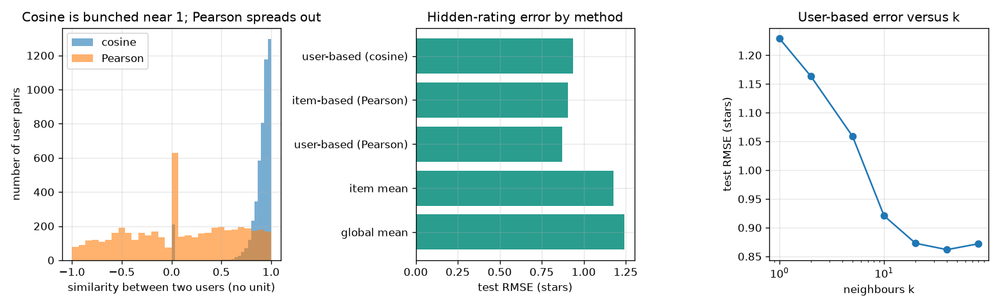

# Session 2: Measure similarity, predict, and test honestly

*Level 2 (mathematical engineering model) · about 75 minutes · openrecommend*

> This is a simplified educational model. It is not a validated design tool and must not be used for real structures, electrical installations, vehicles, industrial processes or medical decisions.

**Prerequisites**

- Session 1: the table, the gap and the neighbour guess.
- Averages and the square root; vectors as lists of numbers (explained in Section B).

**Learning objectives.** After this session you can:

- Compute cosine and Pearson similarity between two users on their co-rated items.
- Predict a missing rating as the user's own average plus a similarity-weighted average of neighbours' surprises.
- Explain the difference between user-based and item-based prediction.
- Evaluate a recommender by hiding known ratings and reporting RMSE and top-N hit rate.

## A. Real-world problem
Session 1 compared 5 people by hand. A real service has thousands of users, each with a few dozen ratings, and you must turn 'similar taste' into a number, turn that number into a predicted rating, and then prove the predictions are any good. How do you test a recommender when you do not know the ratings people have not given yet? (Everything here is a synthetic teaching world; no real person is involved.)

## B. Concept and theory
For two users a and b take the items both rated and call the two lists of ratings x and y. Cosine similarity is the dot product of x and y divided by the product of their lengths. Pearson similarity is the same formula after subtracting each list's own mean, so it ignores whether a user rates everything high or low and only keeps the pattern. With plain 1 to 5 ratings every cosine is positive, so it separates users poorly. To predict, take the user's own mean rating and add the similarity-weighted average of what the k most similar users thought of the item, measured as how far each one's rating is above or below that user's own mean. Item-based prediction runs the same code on the transposed table, so items play the role of users. To evaluate, hide about 20% of the known ratings and compare predictions with the truth: RMSE measures the typical error in stars, and the hit rate at N asks whether a liked hidden item appears in the top N list.

| Symbol | Meaning | Unit |
|---|---|---|
| x, y | ratings of two users on their co-rated items | stars |
| s(a, b) | similarity of users a and b, between -1 and 1 | no unit |
| mean_u | average of the ratings user u has given | stars |
| k | number of neighbours kept | no unit |
| RMSE | root mean squared error on hidden ratings | stars |
| hit rate@N | share of users with a liked hidden item in their top N | no unit |

**Assumptions**

- The synthetic world: each rating is 3.2 plus user and item biases plus 0.8 times a 3-number taste match plus noise, rounded to whole stars.
- Popular items are observed more often, as in real data; this makes the hidden test cells biased towards popular items.
- Pairs with fewer than 3 shared items get similarity 0.
- Educational only; not a validated production system.

$$ \cos(x,y)=\frac{x\cdot y}{\lVert x\rVert\,\lVert y\rVert} $$

$$ \mathrm{pearson}(x,y)=\frac{(x-\bar x)\cdot(y-\bar y)}{\lVert x-\bar x\rVert\,\lVert y-\bar y\rVert} $$

$$ \hat r(u,i)=\bar r_u+\frac{\sum_{v\in N_k}s(u,v)\,\big(r(v,i)-\bar r_v\big)}{\sum_{v\in N_k}\left|s(u,v)\right|} $$

$$ \mathrm{RMSE}=\sqrt{\frac{1}{n}\sum\big(\hat r-r\big)^2} $$

## C. Visual explanation
The left panel shows the similarity of every pair of users under cosine (all bunched on the positive side) and under Pearson (spread from negative to positive). The middle panel compares the hidden-rating error of five methods; the user-based Pearson method has the lowest error at 0.873 stars against 1.179 for the item-mean baseline. The right panel shows the error against the number of neighbours k: it falls from 1.229 at k = 1 to a minimum near k = 40 and rises slightly after that.

*Left: cosine versus Pearson over all user pairs. Middle: test RMSE by method. Right: user-based RMSE against the number of neighbours k.*

## D. Interactive simulation
Run the lesson (`python start.py 2`), then open the live app: [Session 2: cosine, Pearson and one prediction](https://krunalpanchal1995.github.io/openrecommend/session-02/) (or `app.html` in this folder). Change B's ratings with the sliders and watch cosine and Pearson move, then open the prediction view and see how B's rating of a fifth item changes the guess for A.

**Challenge.** Find ratings for B where cosine stays above 0.9 but Pearson is negative: cosine says 'similar', Pearson says 'opposite pattern'.

## E. Worked example and experiment
**Problem.** User A rated four items 5, 3, 4, 4 and has not rated item 5. User B rated them 3, 1, 2, 2 and gave item 5 a 3. Find cosine and Pearson between A and B on the 4 shared items, then predict A's rating for item 5 using B alone.

1. Dot product: 5*3 + 3*1 + 4*2 + 4*2 = 15 + 3 + 8 + 8 = 34. Lengths: sqrt(25+9+16+16) = 8.124 and sqrt(9+1+4+4) = 4.243. Cosine = 34 / (8.124 * 4.243) = 0.986.
2. Pearson: A's mean is 4, so A - 4 = (1, -1, 0, 0). B's mean on the shared items is 2, so B - 2 = (1, -1, 0, 0). The two lists are identical, so Pearson = 1 exactly.
3. B's mean over all 5 of its ratings is (3 + 1 + 2 + 2 + 3) / 5 = 2.2, so B's surprise on item 5 is 3 - 2.2 = 0.8 stars.
4. With one neighbour of similarity 1 the weighted average of surprises is 0.8, so the prediction is A's own mean plus 0.8 = 4 + 0.8 = 4.8 stars.

**Answer.** Cosine 0.986, Pearson 1.0, and the predicted rating of A for item 5 is 4.8 stars.

**Experiment.** Collect ratings for 8 items from 12 friends, hide 2 ratings per friend, predict them with your formula and compute the RMSE against a baseline that always guesses each friend's own average. Expect an improvement of only a fraction of a star: with a dozen people the neighbours are few and the ratings are noisy. The model assumes taste is stable and ratings are honest; real people rate differently on different days and cannot see the hidden ones, so the real error is larger than in the synthetic world.

## F. Assessment and design challenge
**Question type A: Conceptual.** Why does Pearson similarity separate users better than cosine when all ratings are between 1 and 5? What does a negative Pearson mean?

Hint

Cosine of two lists of positive numbers can never be below 0. What does subtracting the mean remove?

Step-by-step solution

With only positive ratings the dot product x . y is always positive, so cosine is always above 0 and mostly close to 1 (the checkpoint confirms no cosine is negative). Subtracting each list's own mean removes 'this user rates everything high' and keeps only the up-and-down pattern, so Pearson can be negative. A negative Pearson means the two users tend to disagree: when one rates an item above their own average, the other rates it below theirs.

**Question type B: Numerical.** Two users share 3 items. User x rated them 5, 3, 1 and user y rated them 4, 4, 1. Compute the cosine and the Pearson similarity (no unit).

Hint

Cosine: dot product over product of lengths. Pearson: first subtract the mean (3 for both) from each list.

Step-by-step solution

Cosine: dot = 20 + 12 + 1 = 33; lengths sqrt(35) = 5.916 and sqrt(33) = 5.745; cosine = 33 / 33.99 = 0.971. Pearson: x - 3 = (2, 0, -2), y - 3 = (1, 1, -2); dot = 2 + 0 + 4 = 6; lengths 2.828 and 2.449; Pearson = 6 / 6.928 = 0.866. Both are below 1, and Pearson is the more demanding of the two.

**Question type C: Graph and simulation interpretation.** In the right panel, the error falls from 1.229 at k = 1. Roughly where is the best k, and why does the error rise again for very large k?

Hint

Compare the values at k = 20, 40 and 80 (0.873, 0.862, 0.872).

Step-by-step solution

The lowest value is 0.862 stars at k = 40; at k = 20 it is 0.873 and at k = 80 it is 0.872, so the curve is flat near the minimum. With k = 1 a single noisy neighbour decides; as k grows noise averages out. For very large k users who are not really similar are included and pull every prediction towards the crowd, so the error stops improving and creeps up.

**Question type D: Design and optimisation challenge.** Design: the checkpoint reports hit rate at 5 of 0.271 for random, 0.747 for popularity, 0.621 for user-based and 0.678 for item-based, but the RMSE of user-based is much better than popularity-like baselines. Which method would you ship for a 'top 5 picks' row, and what would you change in the test before trusting the answer?

Hint

Remember which cells are hidden: only ratings that people actually gave, and popular items get more of them.

Step-by-step solution

On this test popularity wins the top-5 task (0.747 against 0.621 and 0.678), although the neighbour methods predict individual ratings much better (RMSE 0.873 and 0.906 against 1.179 for the item mean). The hidden test cells come from the same exposure-biased process as the training cells, so popular items dominate them and reward a popularity ranking. Before shipping I would test on ratings collected with random exposure, measure more than hit rate (for example variety and novelty), and probably combine popularity with personal scores. Trade-off: the safest pick is not the most personal one.

Score yourself with [RUBRIC.md](../../RUBRIC.md). Print the [activity sheet](activity_sheet.md) to work on paper.

## Common misconceptions
| Common misconception | What is actually true |
|---|---|
| A lower RMSE always means better recommendations. | RMSE scores predicted ratings of hidden cells; a top-N list also depends on the ranking, and in this world popularity wins the hit rate while losing the RMSE. |
| Cosine similarity of 0.98 means two users disagree little. | On 1 to 5 ratings cosine is almost always high; Pearson, which removes each user's average, is the better test of agreement. |
| Testing on the data you trained on is fine if the model is simple. | Predictions must be scored on ratings the model never saw; the checkpoint shows that changing hidden ratings does not change the predictions. |

## Glossary
- **cosine similarity**: dot product of two lists divided by the product of their lengths
- **Pearson similarity**: cosine after subtracting each list's own mean; ranges from -1 to 1
- **user-based**: predict from users similar to the target user
- **item-based**: predict from items similar to the target item (same code on the transposed table)
- **RMSE**: root mean squared error; typical size of a prediction error, in stars
- **hit rate at N**: share of users for whom a liked hidden item appears in their top N list

## Finish
1. Do the three coding tasks in [exercises.md](exercises.md).
2. Run `python start.py 2` again after your changes. It ends with the checkpoint; when it prints `PASS`, you are done. (Checkpoint only: `python start.py check 2`.)

Next: [Session 3](../session-03/README.md)
