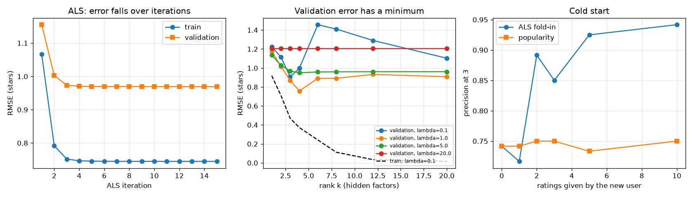
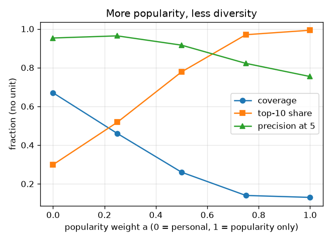

# Session 3: Hidden tastes, cold start and shrinking variety

*Level 3 (simulation and validation) · about 90 minutes · openrecommend*

> This is a simplified educational model. It is not a validated design tool and must not be used for real structures, electrical installations, vehicles, industrial processes or medical decisions.

**Prerequisites**

- Session 2: similarity, prediction, RMSE and hidden test ratings.
- Solving a small system of linear equations is helpful; the ridge step is explained in Section B.

**Learning objectives.** After this session you can:

- Fit a matrix factorisation by alternating least squares and watch the training error fall.
- Choose the rank k and the regularisation lambda on validation data, and report once on test data.
- Recognise overfitting at large k and data leakage, and measure how much each distorts the error.
- Measure the cold-start problem and how popularity fallback and fold-in compare, and measure how popularity weighting shrinks the variety of the recommendations.

## A. Real-world problem
Neighbour methods compare raw pairs of users. A stronger idea is to assume every user and every item can be described by a few hidden numbers (taste factors) and to learn them so that 'user factors times item factors' reproduces the known ratings. Then the awkward questions: how many factors is too many, what do you show a brand-new user who has rated nothing, and what happens to the variety of what is shown when the system leans on popularity? (Education only: real systems must also respect people's privacy and fairness, and everything here is synthetic.)

## B. Concept and theory
Model: rating(u, i) is approximately mu + p_u . q_i, where mu is the average training rating and p_u, q_i are vectors of k hidden numbers for user u and item i. We minimise the squared error on the known training cells plus lambda times the squared lengths of all vectors; lambda (regularisation) punishes large vectors. If the item vectors are frozen, the best p_u is a ridge regression with a closed form that uses only the items u has rated; likewise for the q_i when the user vectors are frozen. Alternating the two solves is alternating least squares (ALS) and each half step can only lower the objective. The training error always falls as k grows, so we choose k and lambda on a separate validation set and quote the error once on a test set. If test ratings leak into training, the reported test error is fake. A new user has no ratings, so p_u cannot be learned: we fall back to popularity, and after m ratings we fold in by solving the ridge problem for p_u with the item vectors frozen. Diversity of a set of lists is measured by coverage (distinct items shown divided by catalogue size) and by the share of slots filled by the 10 most-rated items.

| Symbol | Meaning | Unit |
|---|---|---|
| mu | average training rating | stars |
| p_u, q_i | hidden taste vectors of user u and item i, k numbers each | no unit |
| k | rank: number of hidden factors | no unit |
| lambda | regularisation strength | no unit |
| RMSE | root mean squared error | stars |
| precision at 3 | share of the 3 recommended items that the user likes (rating 4 or 5) | no unit |
| coverage | distinct recommended items divided by catalogue size | no unit |

**Assumptions**

- Synthetic world: 240 users, 100 items, 3 true taste factors; 40 users are held out as brand-new users.
- About 15% of the cells of the other 200 users are observed; training, validation and test cells are split at random (about 70%, 15%, 15% of the observed cells).
- Liked means a true rating of at least 4 in the full synthetic matrix.
- Simplified model for teaching: no time, no clicks, no fairness constraints.

$$ \hat r(u,i)=\mu+p_u\cdot q_i $$

$$ J=\sum_{(u,i)\in\mathrm{train}}\big(r(u,i)-\mu-p_u\cdot q_i\big)^2+\lambda\Big(\sum_u\lVert p_u\rVert^2+\sum_i\lVert q_i\rVert^2\Big) $$

$$ p_u=\big(Q_u^{\mathsf T}Q_u+\lambda I\big)^{-1}Q_u^{\mathsf T}\,(r_u-\mu) $$

$$ \mathrm{coverage}=\frac{\#\{\text{distinct items in all lists}\}}{\#\{\text{items}\}} $$

## C. Visual explanation
The first figure has three panels. On the left, both training and validation error fall over the 15 ALS iterations. In the middle, the validation error against the rank k has a minimum, while the training error keeps falling towards zero: that gap is overfitting. On the right, the cold-start curve shows that popularity is flat at about 0.74 while ALS with fold-in climbs to 0.94 as the new user gives more ratings. The second figure shows what happens to variety as the recommendation leans more on popularity: coverage falls from 0.67 to 0.13 and the share of slots taken by the 10 most-rated items rises from 0.30 to 0.99.

*Left: ALS error against iteration. Middle: validation error against rank k for four values of lambda, with the training error dashed. Right: cold-start precision at 3 against the number of ratings given.*

*More weight on popularity: coverage falls, the top-10 share rises, precision at 5 falls from 0.95 to 0.75.*

## D. Interactive simulation
Run the lesson (`python start.py 3`), then open the live app: [Session 3: rank k, lambda and overfitting](https://krunalpanchal1995.github.io/openrecommend/session-03/) (or `app.html` in this folder). Pick a rank k and a lambda with the sliders, compare the training and validation curves, then open the grid and look for the setting with the lowest validation error.

**Challenge.** Find the setting with the lowest validation error (hint: it is not the largest rank).

## E. Worked example and experiment
**Problem.** One ridge step by hand. Two items have one-number vectors q = 1 and q = 2. A user (with mu = 3) rated them 4 and 5, so the centred ratings are 1 and 2. Find the user's vector p for lambda = 1 and for lambda = 0, and the predicted rating for an item with q = 2.

1. For one hidden factor, p = (sum of q * centred rating) / (sum of q squared + lambda).
2. Numerator: 1*1 + 2*2 = 5. Sum of q squared: 1 + 4 = 5.
3. With lambda = 1: p = 5 / (5 + 1) = 0.8333. With lambda = 0: p = 5 / 5 = 1, an exact fit (1*1 = 1 and 1*2 = 2).
4. Prediction for an item with q = 2: with lambda = 1 it is 3 + 0.8333*2 = 4.667; with lambda = 0 it is 3 + 1*2 = 5.

**Answer.** p = 0.8333 (lambda = 1) against p = 1 (lambda = 0); regularisation shrinks the vector and the prediction from 5 to 4.667 stars.

**Experiment.** Split a small public ratings file (or ratings you collect from classmates) into train, validation and test parts, fit with several ranks, and plot the validation error against k. You should see the same U shape, but the minimum will sit at a different k because real tastes are not exactly low rank and ratings are noisier. The synthetic world has exactly 3 true factors plus biases, which is why k = 4 wins here; real data never tells you the true k.

## Real-world application and mini-project: Recommend 3 items for a new user and beat the popularity baseline
A streaming app has 40 brand-new users. For each user, the app asks for m ratings of random items and then recommends 3 unseen items. Use `build_world`, `als` (with k = 4 and lambda = 1), `cold_start_curve` and `popularity_order` from Session 3. For m = 0, 1, 2, 3, 5 and 10 compute precision at 3 (the share of the 3 recommended items the user likes) for ALS fold-in and for the popularity baseline, then find the smallest m for which ALS beats popularity by at least 0.10.

**Deliverable:** A script that prints a table of m, ALS precision and popularity precision, names the smallest m that meets the 0.10 margin, and saves a plot of both curves against m.

**Success looks like:** The smallest m is 2 (ALS 0.89 against popularity 0.75), and with 5 ratings ALS reaches 0.93 against 0.73 for popularity. At m = 0 both are the same, 0.74, because ALS has nothing to learn from and falls back to popularity.

## F. Assessment and design challenge
**Question type A: Conceptual.** Why can the training error go to zero while the model gets worse on new ratings? What is the role of lambda?

Hint

With k = 20 factors per user and only a handful of ratings per user, how many numbers are being fitted per rating?

Step-by-step solution

With many factors the model has enough freedom to memorise every training rating, noise included, so the training error falls (to 0.016 stars at k = 20, lambda = 0.1) while the validation error is 1.103 stars. It has learned the noise, not the tastes. Lambda punishes long vectors, so a larger lambda limits the memorising: at k = 20 raising lambda from 0.1 to 1 lowers the validation error from 1.103 to 0.908.

**Question type B: Numerical.** Redo the worked example with the user's ratings 3 and 5 (centred ratings 0 and 2, mu = 3). Find p for lambda = 1 and lambda = 0 and the predicted rating for q = 2.

Hint

p = (sum of q * centred rating) / (sum of q squared + lambda); the numerator is 1*0 + 2*2.

Step-by-step solution

Numerator 4, sum of q squared 5. Lambda = 0: p = 4/5 = 0.8 and the prediction for q = 2 is 3 + 0.8*2 = 4.6 stars. Lambda = 1: p = 4/6 = 0.667 and the prediction is 3 + 0.667*2 = 4.333 stars. The regularised fit is pulled towards 0, towards the plain average rating of 3.

**Question type C: Graph and simulation interpretation.** In the grid of validation errors, where is the minimum, and what happens in the column lambda = 20 for every k?

Hint

Read the smallest number in the grid; look at the lambda = 20 row.

Step-by-step solution

The minimum is 0.758 stars at k = 4, lambda = 1. For lambda = 20 the validation error is 1.208 for every k: the penalty is so heavy that all vectors collapse to zero and the model just predicts the average rating mu. That is underfitting, the opposite failure to overfitting.

**Question type D: Design and optimisation challenge.** Design: the onboarding screen of a new app can ask a new user for m ratings (0, 1, 2, 3, 5 or 10). Using precision at 3 for ALS fold-in (0.74, 0.72, 0.89, 0.85, 0.93, 0.94) and for popularity (0.74, 0.74, 0.75, 0.75, 0.73, 0.75), choose m and justify it. What would you do before the user has rated anything?

Hint

Where does the ALS curve cross the popularity curve, and where does it flatten?

Step-by-step solution

With 0 ratings ALS has nothing to learn from and equals popularity (0.74), so show popular items. With 1 rating ALS is not yet better (0.72 against 0.74). From 2 ratings on it beats popularity clearly (0.89 against 0.75), and at 5 ratings it reaches 0.93; the step from 5 to 10 adds only 0.01. Asking for 5 ratings is a sensible trade-off between effort for the user and accuracy. Caveat: only 40 new users were simulated, so the curve is not smooth (3 ratings scores below 2); treat differences of a few hundredths as noise.

Score yourself with [RUBRIC.md](../../RUBRIC.md). Print the [activity sheet](activity_sheet.md) to work on paper.

## Common misconceptions
| Common misconception | What is actually true |
|---|---|
| A lower training error means a better model. | Training error always falls as k grows; only validation and test error show whether the model generalises. |
| It is fine to peek at the test ratings while tuning. | Leaking test ratings into training gave a fake test RMSE of 0.017 where the honest value is 1.049. |
| Personalisation always makes recommendations more diverse. | Weighting popularity makes lists collapse onto the same few items: coverage fell from 0.67 to 0.13 in the experiment. |
| A new user needs a different algorithm. | Only the information differs: with no ratings we use popularity, and with a few ratings the same item vectors give a fold-in estimate. |

## Glossary
- **matrix factorisation**: approximating the ratings table by the product of user vectors and item vectors
- **rank k**: number of hidden factors per user and per item
- **ALS**: alternating least squares: solve for users with items frozen, then for items with users frozen, and repeat
- **regularisation (lambda)**: a penalty on large vectors that limits overfitting
- **overfitting**: fitting noise: very low training error but higher validation error
- **data leakage**: test information reaching the training data, which makes the test score meaningless
- **cold start**: the situation of a new user or item with no ratings
- **coverage**: share of the catalogue that appears in recommendation lists

## Finish
1. Do the three coding tasks in [exercises.md](exercises.md).
2. Run `python start.py 3` again after your changes. It ends with the checkpoint; when it prints `PASS`, you are done. (Checkpoint only: `python start.py check 3`.)

Next: the [roadmap](../../promo/roadmap.md). Session 4 is yours to build.
